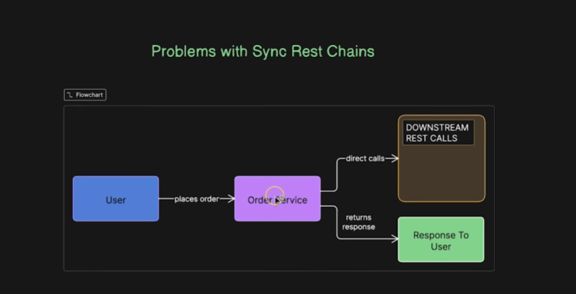
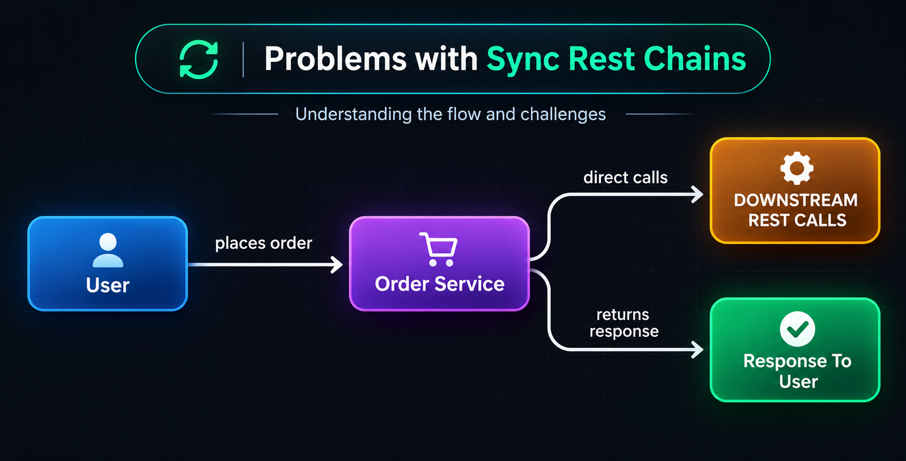
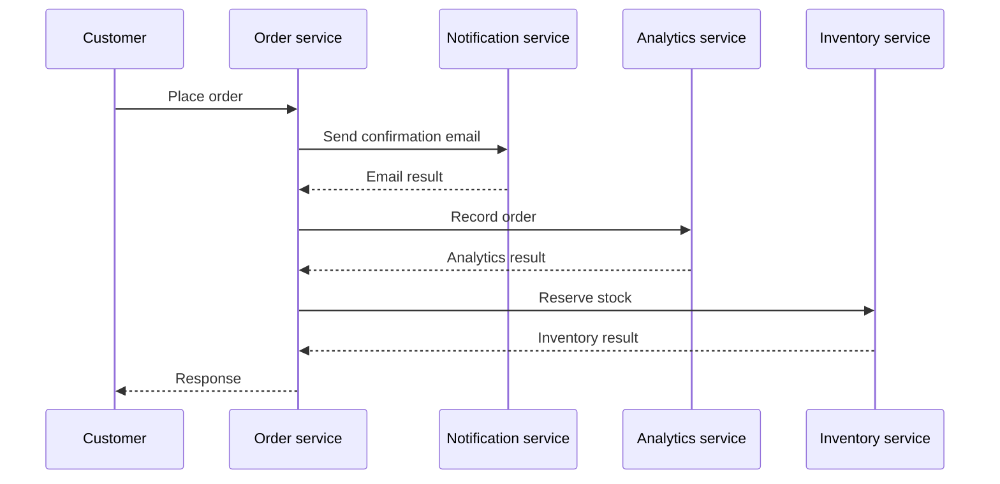
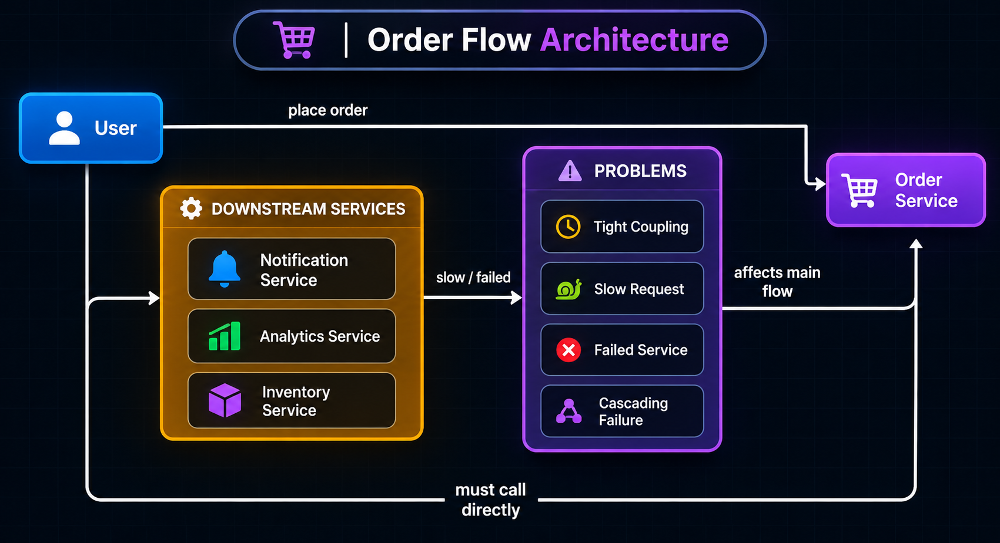
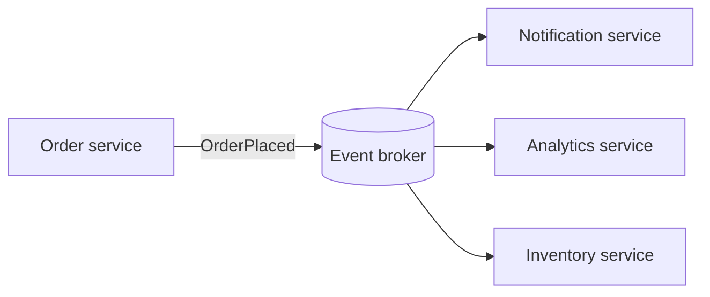

# 1. The Problem with Synchronous REST Chains

Imagine an order service that creates an order and then calls several other services before responding to the customer.






In a synchronous REST call, the caller waits for the downstream service to respond. If the order request waits for notifications, analytics, and inventory, the customer-facing response depends on all of them.

```ts
try {
  await createOrder(orderData);
  await notifyUser(orderData);
  await recordAnalytics(orderData);
  await updateInventory(orderData);
} catch (error) {
  // Decide how to report or recover from the failed operation.
}
```

## What can go wrong?

- **Latency adds up:** If three sequential dependencies take 300 ms, 500 ms, and 700 ms, the caller waits for at least 1.5 seconds, plus network and order-service time.
- **Failure spreads:** A slow or unavailable downstream service can slow or fail the whole request.
- **Tight coupling:** The order service needs to know which services to call and their APIs.
- **Harder changes:** Adding a new downstream service means changing and redeploying the order service.
- **Retries can amplify load:** Retrying every failed call without limits can overload an already struggling service.



Synchronous calls are still useful when the caller needs an immediate answer—for example, checking whether an item is currently available. The problem is using a long chain for work that can happen asynchronously.

## A better fit for background reactions

For work that does not need to finish before responding, the order service can publish an `OrderPlaced` event. A broker stores it, and other services process it independently. This reduces direct dependencies, but introduces new responsibilities: retries, duplicate handling, event retention, and monitoring.



| Requirement | Typical fit |
|---|---|
| Caller needs a result immediately | Synchronous request/response |
| Work can finish later | Queue or event stream |
| Many independent systems need the same history | Retained event stream such as Kafka |

### Real-life example

After an online purchase, the checkout API may need to confirm that the order was accepted. Sending an email and updating a dashboard do not usually need to block that response. Publishing an event lets those tasks proceed separately.

**Benefits:** faster, less coupled request paths and independent downstream scaling.

**Trade-offs:** the response may precede downstream completion; consumers must handle retries and duplicates, and the system needs observability.

## Next

- [Queues](02_queues.md) introduce broker-based asynchronous work.
- [Kafka's mental model](03_kafka_mental_model.md) explains how Kafka differs from a basic queue.
