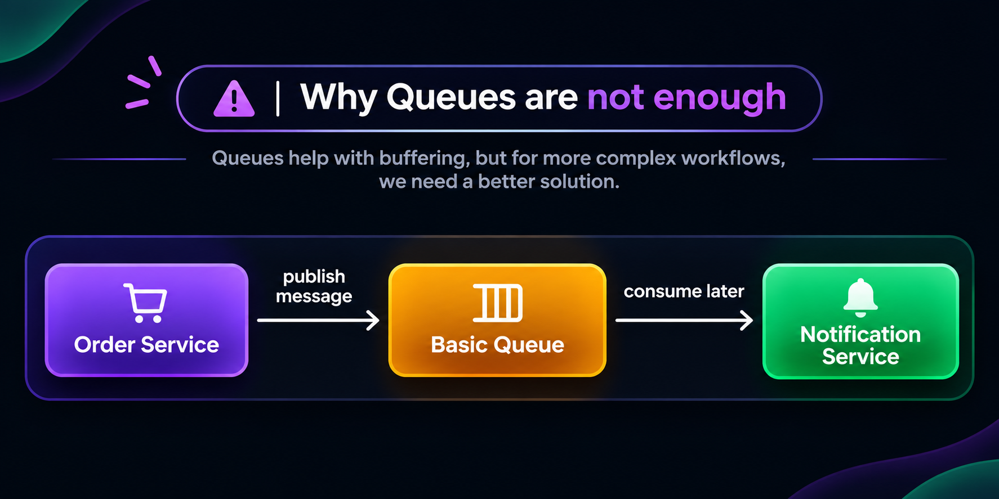
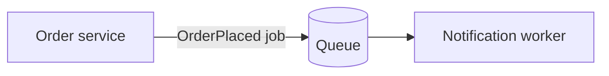
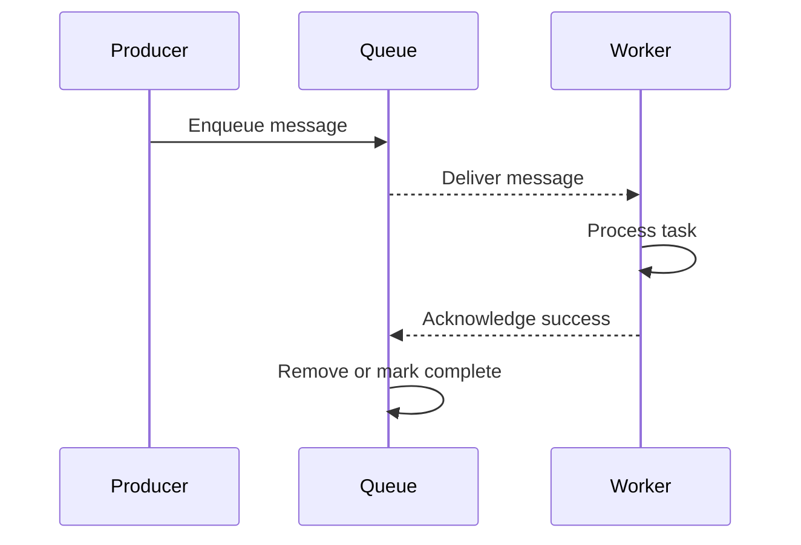

# 2. Queues: A Buffer Between Services

A message queue gives a producer and a worker a buffer between them. The producer places work in the queue and can continue; a consumer receives the message and performs the task.





For example, the order service can enqueue a notification request:

```json
{
  "eventType": "OrderPlaced",
  "orderId": "1141",
  "userId": "1223"
}
```

The notification worker later reads the message and sends an email. The order service does not wait for the email provider to finish.

## How a work queue behaves



In many queue systems, a message is acknowledged after successful processing and then removed or marked complete. If a worker fails before acknowledgment, the broker may make the message available again. Exact behavior depends on the queue product and its configuration.

### One queue per kind of work

```text
Order service --> notification-queue --> notification workers
Order service --> analytics-queue -----> analytics workers
Order service --> inventory-queue -----> inventory workers
```

This design can distribute work among multiple workers. It is a useful pattern for background jobs such as sending email, generating a report, or resizing an image.

## Queue versus Kafka at a glance

| Question | Typical work queue | Kafka topic |
|---|---|---|
| Main purpose | Distribute tasks to workers | Store and distribute an event stream |
| After successful consumption | Often acknowledged and removed | Usually retained according to topic policy |
| Independent readers | Often requires separate queues or fan-out | Separate consumer groups can read the same retained records |
| Replay older data | Product-specific and often not the default | Consumers can reread retained records by changing offsets |

These are common patterns, not universal rules: queue products and Kafka can both support more than one delivery model.

### Real-life example

A photo-upload service can place a thumbnail-generation job on a queue. Several workers can compete for jobs; each completed job is acknowledged. If thumbnail generation fails, the broker can redeliver the job, subject to its retry and dead-letter configuration.

**Advantages:** simple work distribution, buffering during bursts, and reduced direct coupling.

**Trade-offs:** retries can cause duplicate work; old messages may not be available for replay; a separate queue or fan-out mechanism may be needed for multiple independent subscribers.

Use a queue when the central need is “one worker should complete this task.” Use a retained event stream when multiple systems need to independently observe and possibly replay what happened.

## Next

Continue with [Kafka's mental model](03_kafka_mental_model.md), then see [topics](04_topics.md), [partitions](05_partitions.md), and [offsets](06_offsets.md).
