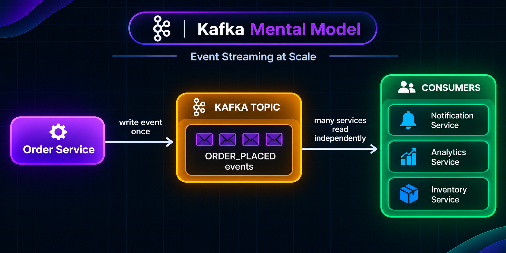
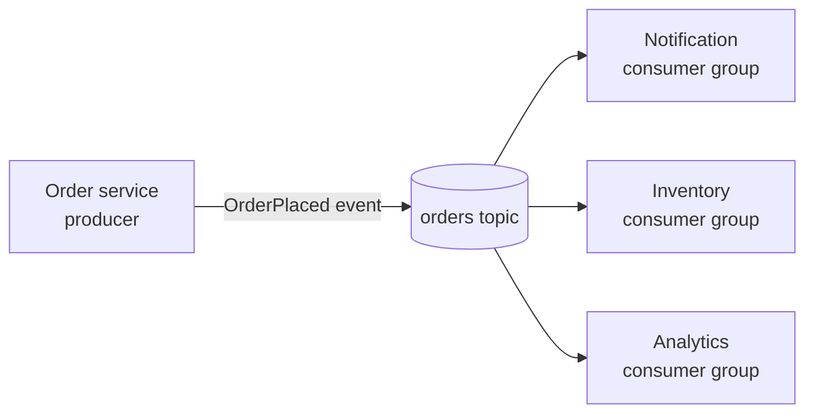
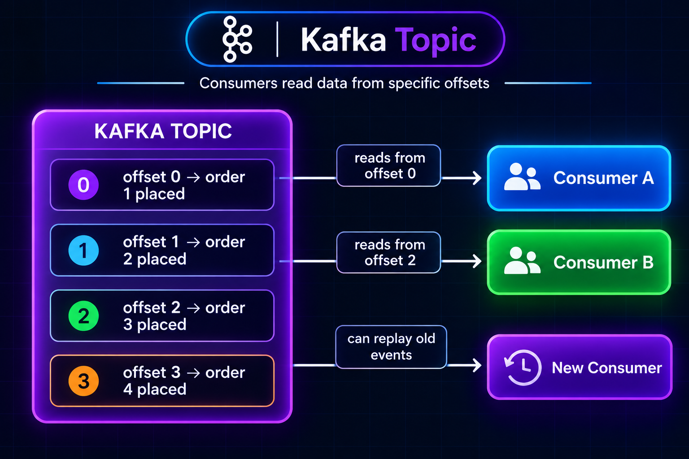

# 3. Kafka's Mental Model

Apache Kafka is a distributed event-streaming platform. The most useful mental model is **a durable, partitioned log**: producers append records, and consumers independently read the log at their own pace.





The order service publishes an event such as:

```json
{
  "eventType": "OrderPlaced",
  "orderId": "1141",
  "userId": "1223",
  "amount": 235.34
}
```

Kafka writes the record to a topic. Notification, inventory, and analytics can each read the same event independently by using different consumer groups.

## Records are retained; readers track progress

Kafka normally does not delete a record just because one consumer read it. Topic retention settings control how long records are kept (or, for compacted topics, which keyed records are retained). Each consumer group tracks its own progress using offsets.

```text
orders topic (partition 0)
offset:       0             1             2             3
record:   OrderPlaced   OrderPlaced   OrderPlaced   OrderPlaced
              ^ notification group
                            ^ inventory group
                                          ^ analytics group
```

The arrows illustrate independent reader positions; consumers do not remove records when they read them.

| Consumer group | Typical purpose | Progress |
|---|---|---|
| `notifications` | Send customer updates | Its own committed offsets |
| `inventory` | Reserve stock | Its own committed offsets |
| `analytics` | Aggregate sales | Its own committed offsets |

If analytics is offline for 20 minutes, it can catch up later if the records are still within the topic's retention period. A newly added fraud-detection group can also read retained historical events.



## Kafka is not just a queue

| Basic queue pattern | Kafka mental model |
|---|---|
| A worker typically takes a task and acknowledges it | A consumer reads records and tracks its offset |
| Acknowledged task is often removed | Records are retained according to topic policy |
| Multiple readers often need fan-out setup | Independent consumer groups can read the same topic |
| Replay is product-specific | Replay is possible while records are retained |

Kafka also supports competing consumers: consumers in the **same group** divide partitions among themselves. Different groups each get independent read positions.

## Practical mental model summary

- **Producer:** appends a record.
- **Topic:** named stream that groups related records.
- **Partition:** ordered section of a topic.
- **Offset:** record position inside one partition.
- **Consumer group:** readers that share the work and progress for a subscription.
- **Retention:** determines whether an older record remains available.

Kafka is not a relational database or an automatic workflow engine. Applications still need to define event meaning, handle duplicate processing, and decide what to do when a consumer fails.

**Benefits:** decoupled readers, replay, and scalable event distribution.

**Trade-offs:** retention is finite or policy-driven, and consumers must manage progress and failure recovery.

## Next

- Learn what belongs in a [topic](04_topics.md).
- See how Kafka distributes records across [partitions](05_partitions.md).
- Understand consumer progress in [offsets](06_offsets.md).
