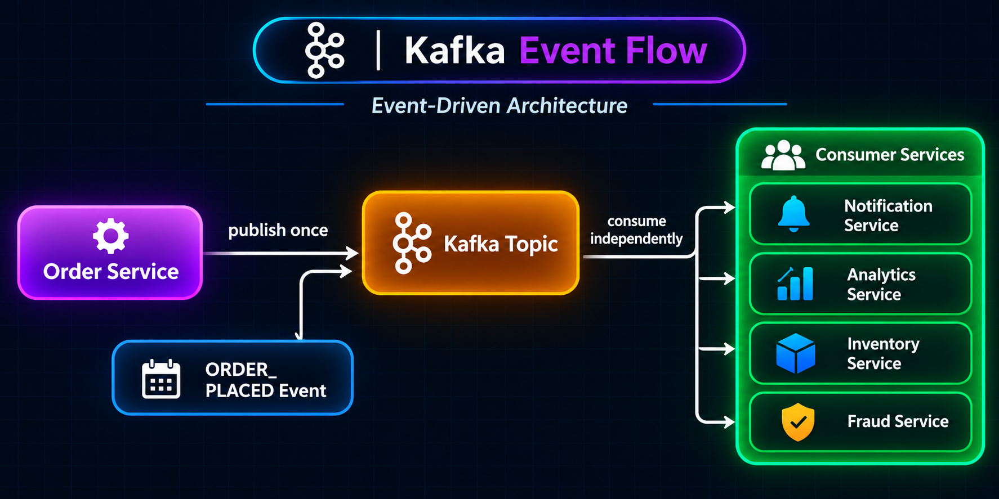
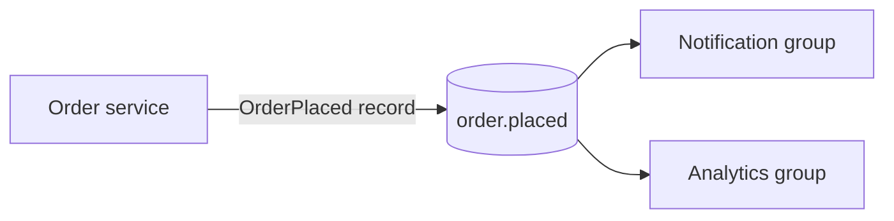

# 4. Kafka Topics

A **topic** is a named stream of related records. Producers write records to topics; consumers choose which topics to read.



Examples of topic names:

```text
order.placed
payment.completed
payment.rejected
user.registered
```



The producer publishes to a topic, but it does not need to know every consumer. Consumers subscribe to topics and decide how to process the records.

## A topic is not a database table

| Kafka topic | Database table |
|---|---|
| An append-oriented stream of records | A collection of current rows |
| Records are read in log order within each partition | Rows can be queried by columns and predicates |
| A consumer tracks its own position | A database query does not normally use a Kafka-style group offset |
| Retention or compaction controls stored records | Database-specific updates and deletion control rows |

Kafka is useful for distributing changes and events; it is not designed for arbitrary queries such as “return all orders over $100 for this customer.”

## Topic records and retention

A topic is divided into one or more partitions. Records are stored for a configured time or size limit, or a topic can use log compaction to retain the latest value for each key (subject to compaction behavior). Reading a record does not normally remove it.

Choose topic names and event boundaries that are clear to the teams producing and consuming them. A topic such as `order.events` may carry several order event types; separate topics such as `order.placed` and `order.cancelled` may be appropriate when they need different access, retention, or operational settings.

| Design question | Consideration |
|---|---|
| What does one record mean? | Prefer a clear event contract, such as `OrderPlaced`. |
| Who owns the event format? | Define ownership and compatibility expectations. |
| How long must events be available? | Set retention to match replay and recovery needs. |
| Are records keyed? | Keys affect partition assignment and compaction behavior. |

### Real-life example

An e-commerce platform might publish `order.placed` events for checkout, `payment.completed` events for fulfillment, and `user.registered` events for onboarding. Each topic represents a stream consumers can subscribe to.

**Benefits:** clear event boundaries, independent subscriptions, and topic-level policies.

**Trade-offs:** too many poorly governed topics complicate access, retention, and ownership; topic records are not a substitute for application-state queries.

## Next

Topics are made of [partitions](05_partitions.md); consumers use [offsets](06_offsets.md) to track their place in those logs.
