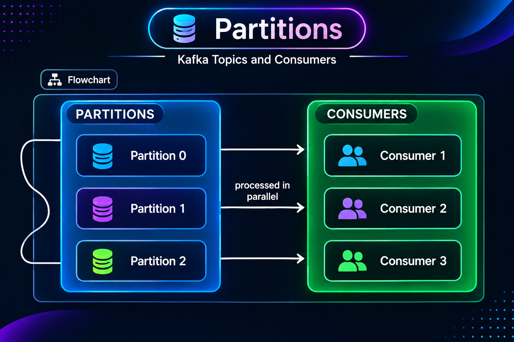
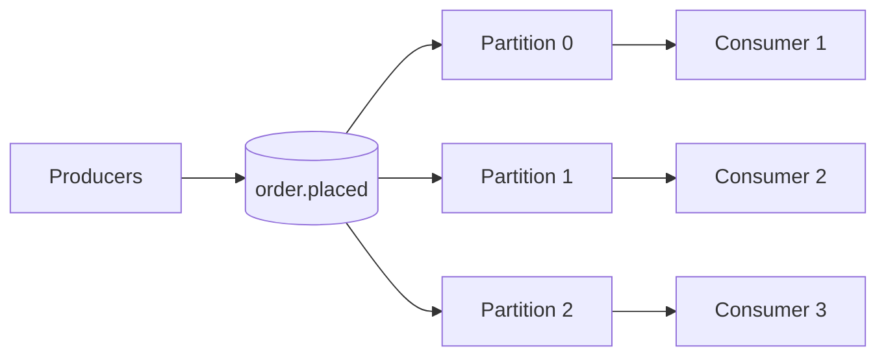

# 5. Kafka Partitions

A **partition** is an ordered, append-only log inside a topic. A topic can have multiple partitions, which lets Kafka distribute storage and work across a cluster.



```text
Topic: order.placed

Partition 0: [event] [event] [event] [event]  --->
Partition 1: [event] [event] [event]         --->
Partition 2: [event] [event] [event] [event]  --->
```

Kafka assigns each record to one partition. Within that partition, records have a defined order. There is no single total order across all partitions.

## Why use partitions?

Suppose one topic receives many order events. Splitting it into partitions allows Kafka to place the partition logs across brokers and allows consumers in one group to process different partitions concurrently.



Example records may be distributed like this:

```text
Partition 0: order_1001, order_1004, order_1005
Partition 1: order_1002, order_1003
Partition 2: order_1010, order_1011
```

The example shows partition placement, not a global event order.

## Keys and ordering

When a producer supplies a key, Kafka's default partitioner generally hashes that key to select a partition. Records with the same key are therefore routed to the same partition for a stable partition count and partitioner. This helps preserve per-key ordering.

For example, keying by `customerId` can keep one customer's account events together:

```text
customer-42: OrderPlaced   --> Partition 1
customer-42: OrderUpdated  --> Partition 1
customer-42: OrderCanceled --> Partition 1
```

Partition assignment can change if the partition count or partitioning strategy changes. Do not treat key-to-partition placement as a permanent global identity.

## Partitions and consumer parallelism

Within one consumer group, one partition is assigned to at most one consumer at a time. If a topic has three partitions, a group can usefully process up to three partitions concurrently; extra consumers may be idle. Different consumer groups can read the same partitions independently.

| Partition count | Potential parallelism per group | Main consideration |
|---:|---:|---|
| 1 | 1 consumer | Simple ordering; limited throughput |
| 3 | Up to 3 consumers | More parallel work; ordering remains per partition |
| 10 | Up to 10 consumers | More capacity potential and more resources to manage |

More partitions do not guarantee higher throughput: producers, brokers, disks, network, and consumer processing can all be bottlenecks. Partition count is an important design choice; increasing it later can affect key placement and ordering expectations.

### Advantages and trade-offs

- **Advantages:** distributes data, supports parallel consumption, and preserves order within each partition.
- **Trade-offs:** order across partitions is not guaranteed; too many partitions increase resource and operational overhead.

### Real-life example

An order topic keyed by `customerId` can process different customers in parallel while preserving the order of events for each customer. If the business requires one strict order for every order event globally, a single partition is the straightforward model—but limits parallelism.

## Next

See how a consumer remembers its place in each [partition with offsets](06_offsets.md), and how a [producer chooses keys and sends records](07_producers.md).
