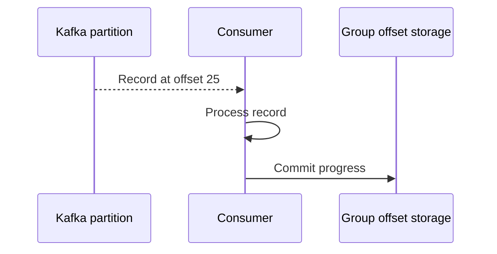

# 6. Kafka Offsets

An **offset** is a record's position within one partition. Kafka uses offsets so a consumer group can track where it has read and resume after a restart.

```text
Topic: order.placed

Partition 0
offset 0 -> order_1001
offset 1 -> order_1004
offset 2 -> order_1007
offset 3 -> order_1010
```

An offset is not an event ID, order ID, or timestamp. It is a position in one partition. The same offset value can exist in several partitions:

```text
Partition 0: offset 0, offset 1, offset 2 ...
Partition 1: offset 0, offset 1, offset 2 ...
```

## Consumer-group progress

Each consumer group commits progress independently. For a topic with several partitions, a group tracks offsets for each assigned partition—not one global topic offset.

```text
                         Partition 0       Partition 1
notifications group      committed: 25     committed: 11
analytics group          committed: 12     committed: 8
```

The values above are examples of committed positions; tools may display the next offset to consume, and the exact presentation depends on the client and command.



## What happens after a failure?

- If processing succeeds but the offset is not committed before a crash, the record may be delivered again. This is a common source of **at-least-once** processing and duplicates.
- If an offset is committed before the work is safely finished, a crash can cause the record to be skipped on restart.
- Committing after successful processing is often a sensible starting point, but it does not make an external database write and the Kafka offset commit one atomic operation.

For that reason, consumers should use idempotent operations where possible—for example, store the event ID with a uniqueness constraint so a repeated event does not apply the same business action twice.

## Replay and retention

Changing a group's offsets can make it reread records that Kafka still retains. This is useful for rebuilding a projection or recovering from a bug, but replaying events can repeat side effects. Plan for idempotency before resetting offsets.

| Term | Meaning |
|---|---|
| Current/consumer position | Where the consumer is reading now |
| Committed offset | Progress saved for the group |
| Lag | Approximate distance between the log end and the group's progress |
| Retention | How long/which records remain available for reading |

**Benefits:** offsets allow independent progress, recovery, lag monitoring, and replay.

**Trade-offs:** commit timing affects duplicates or missed work; replay is possible only while the data remains available and can repeat side effects.

## Next

Offsets are produced as records are written and consumed. Learn about [producers](07_producers.md) and [consumers](08_consumers.md).
