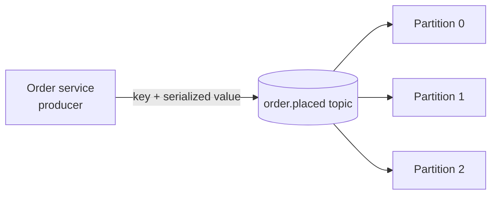
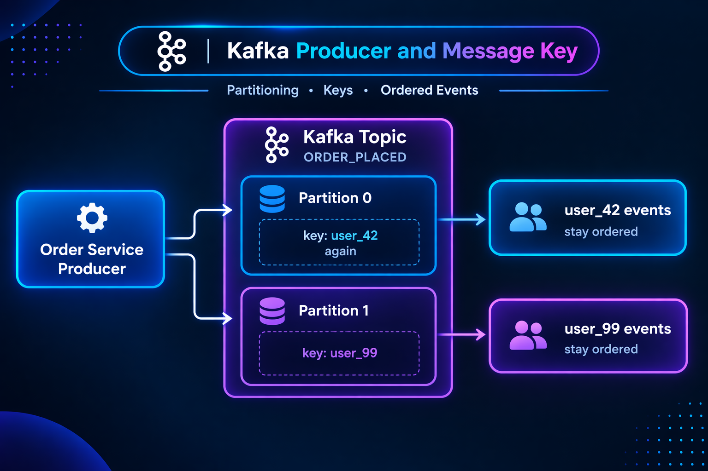

# 7. Kafka Producers

A **producer** is an application that writes records to Kafka topics. For example, an order service can publish an `OrderPlaced` event to the `order.placed` topic.





## Anatomy of a record

| Field | Purpose | Example |
|---|---|---|
| Topic | Destination stream | `order.placed` |
| Key | Optional routing/grouping value | `user_42` |
| Value | Event payload, encoded as bytes | JSON order event |
| Headers | Optional metadata | Trace ID or schema information |
| Timestamp | Event/record time | Set by the producer or broker |

A record's key is separate from its value. Kafka stores key and value as bytes, so the producer serializes them and consumers deserialize them using a compatible format.

## Sending a keyed event with KafkaJS

The following example assumes KafkaJS is installed and a Kafka broker is running. It creates a producer, publishes one JSON value, and disconnects cleanly:

```js
const { Kafka } = require('kafkajs');

const kafka = new Kafka({
  clientId: 'order-service',
  brokers: ['localhost:9092'],
});

async function publishOrderPlaced(order) {
  const producer = kafka.producer();

  await producer.connect();
  try {
    const result = await producer.send({
      topic: 'order.placed',
      messages: [
        {
          key: order.userId,
          value: JSON.stringify({
            eventType: 'OrderPlaced',
            orderId: order.id,
            userId: order.userId,
            amount: order.amount,
          }),
        },
      ],
    });

    return result;
  } finally {
    await producer.disconnect();
  }
}
```

In a long-running service, connect once during application startup and reuse the producer; disconnect during graceful shutdown rather than reconnecting for every event.

## Why use a key?

Kafka's default partitioner generally routes the same key to the same partition while the partition count and partitioner remain stable. That makes a key useful when the order of events for one entity matters.

```text
key: user_42
OrderPlaced   -> partition 1
OrderUpdated  -> partition 1
OrderCanceled -> partition 1
```

The partition number is illustrative. A changed partition count or custom partitioner can change placement. Without a key, Kafka may distribute records without preserving per-entity ordering.

## Producer process and reliability choices

1. Build the event and choose its topic and optional key.
2. Serialize the key and value into bytes.
3. Select a partition (by key/default partitioner or explicit configuration).
4. Send the record to the partition leader.
5. Receive success or an error according to the producer's acknowledgment and retry settings.

Producer settings such as acknowledgments, idempotence, retries, and batching affect durability, duplicate risk, ordering, throughput, and latency. Choose them for the Kafka cluster and the application's delivery requirements; no single setting makes the entire end-to-end business operation exactly once.

| Choice | Typical effect |
|---|---|
| Stable key | Keeps related records together for per-key ordering |
| Batching | Can improve throughput, with a latency trade-off |
| Retries | Can recover transient errors; consider duplicate and ordering behavior |
| Acknowledgment policy | Controls when the producer considers a write successful |

### Real-life example

An order service publishes `OrderPlaced` with `userId` as the key. A downstream service can then process one user's order events in partition order while different users are handled concurrently.

**Advantages:** decouples the service from downstream readers, supports asynchronous writes, and allows multiple consumer groups to use the event.

**Trade-offs:** producer errors and retries need explicit handling; incorrect keys can undermine ordering or create hot partitions; schema changes require compatibility planning.

## Next

The producer writes records; [consumers](08_consumers.md) subscribe and process them. The [partition](05_partitions.md) and [offset](06_offsets.md) chapters explain where records go and how readers track progress.
