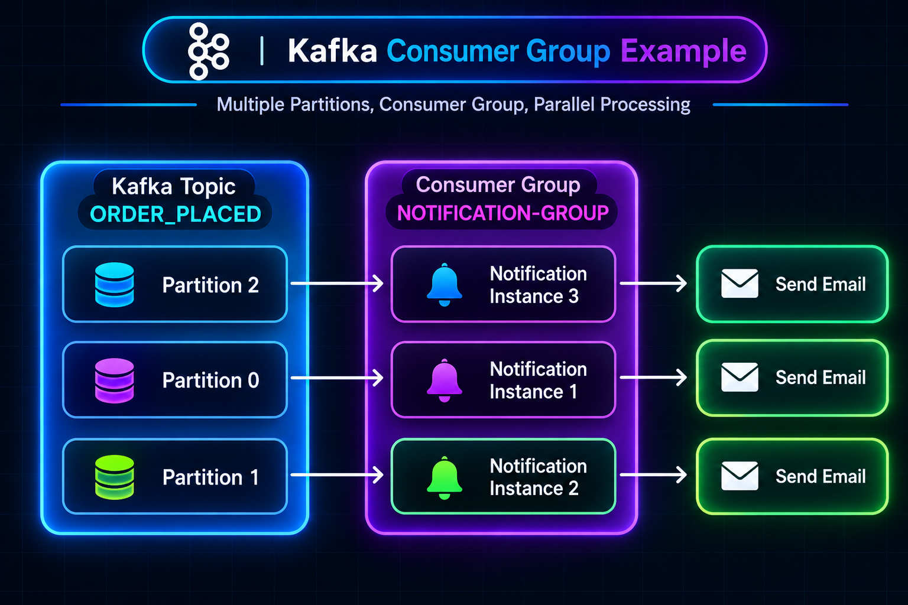
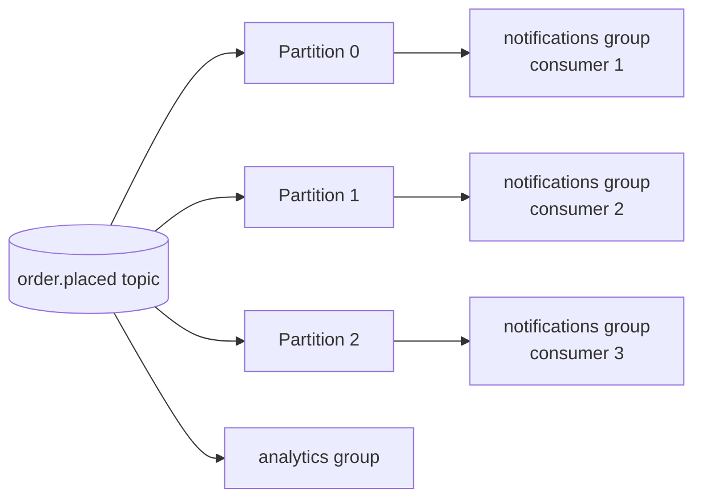
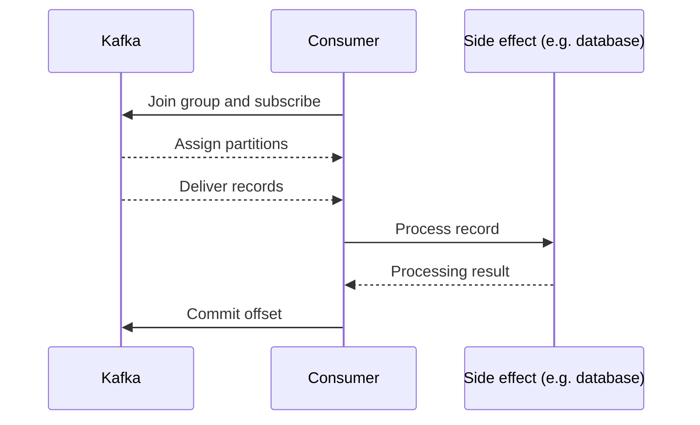

# 8. Kafka Consumers

A **consumer** is an application that reads records from Kafka topics and performs work with them. A consumer typically connects to a broker, subscribes to one or more topics, processes records, and commits progress for its consumer group.





## Consumer groups

Consumers with the same `group.id` cooperate and share a topic's partitions. A partition is assigned to at most one consumer in that group at a time. If the group has more consumers than partitions, some consumers will be idle.

Different group IDs have independent progress. For example, the `notifications` group and `analytics` group can both read the same retained `order.placed` records without taking records away from each other.

| Setup | Result |
|---|---|
| 3 partitions, 1 consumer in a group | One consumer reads all 3 partitions |
| 3 partitions, 3 consumers in a group | Each consumer can receive one partition |
| 3 partitions, 5 consumers in a group | At least 2 consumers are idle |
| Another group ID | Independent subscription and offsets |

## Consumer workflow

1. Connect to Kafka using a bootstrap broker address.
2. Join a consumer group and subscribe to topics.
3. Kafka assigns partitions to group members.
4. Fetch records and process them.
5. Commit offsets at an appropriate point.
6. Handle shutdown, errors, and rebalances safely.



## Basic KafkaJS consumer example

This example reads JSON values from a topic. In production, validate the payload and make the side effect idempotent before committing progress.

```js
const { Kafka } = require('kafkajs');

const kafka = new Kafka({
  clientId: 'notification-service',
  brokers: ['localhost:9092'],
});

async function startConsumer() {
  const consumer = kafka.consumer({ groupId: 'notifications' });

  await consumer.connect();
  await consumer.subscribe({
    topic: 'order.placed',
    fromBeginning: false,
  });

  await consumer.run({
    eachMessage: async ({ topic, partition, message }) => {
      const event = JSON.parse(message.value.toString());

      console.log({
        topic,
        partition,
        offset: message.offset,
        event,
      });

      // Process the event here; make external side effects idempotent.
    },
  });
}

startConsumer().catch((error) => {
  console.error('Consumer failed:', error);
  process.exitCode = 1;
});
```

With `fromBeginning: false`, a new group normally starts at the latest end when it has no committed offsets; existing groups continue from their stored progress. Choose `fromBeginning: true` when a new group should read retained history.

## Failures, retries, and rebalances

- **Duplicate processing:** If work succeeds but the offset commit does not, Kafka may deliver the record again. Use idempotent processing.
- **Skipped work:** Committing before processing is safely complete risks skipping work after a crash.
- **Slow processing:** Long handlers can affect polling and group membership; use the client library's guidance for long tasks and heartbeats.
- **Rebalance:** When group membership or partition assignments change, consumers may lose and regain partitions. Finish or safely pause work and avoid assuming assignments are permanent.
- **Poison messages:** A record that always fails needs a retry limit and a deliberate recovery route, such as a dead-letter topic.

Kafka offset commits and external database/API side effects are not automatically one atomic transaction. Design for the failure window between doing the work and committing the offset.

### Real-life example

Three notification-service instances in one group can share three topic partitions. A separate analytics group can independently read the same orders. If a notification instance stops, Kafka can assign its partitions to surviving group members; the group resumes from committed offsets, subject to possible redelivery.

**Advantages:** consumers scale independently, recover from stored progress, and multiple groups can process the same event stream.

**Trade-offs:** group coordination and offset management add complexity; partition count limits parallelism; retries can repeat side effects.

## Continue learning

Review [offsets](06_offsets.md) for progress tracking and [producers](07_producers.md) for publishing records. For the full sequence, start with [synchronous REST chains](01_problem_with_sync_rest_chains.md).
