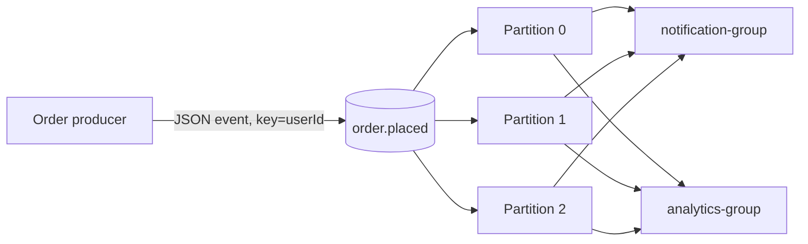

# Kafka Practice: Setup, Errors, and How the Demo Works

This guide covers the TypeScript Kafka practice project in this folder. It publishes simulated `ORDER_PLACED` events and has two independent consumer groups: notifications and analytics.

## What was fixed

| Problem | Fix |
|---|---|
| Consumers parsed a missing or malformed payload as `{}` and trusted it as an order event. | Added `parseOrderPlacedEvent` to reject null, invalid JSON, and payloads that do not match the event contract. |
| Topic creation always printed “topic created,” even if Kafka reported that the topic already existed. | The script now reports whether it created the topic or found it already present. |
| Producer used an asynchronous `setInterval`; slow sends could overlap, and a rejected send could become an unhandled promise rejection. | The producer now sends sequentially in a loop and reports failures through its main error handler. |
| Producer/consumer startup errors were mislabeled or hid the actual error. | Error handlers now include the original error and the relevant component name. |
| Producer and consumer shutdown handlers called `process.exit()` immediately. | They now disconnect and allow the process to finish gracefully. |
| Producer used an implicit global `crypto` reference. | It now imports `randomUUID` from Node's `node:crypto` module. |

## Requirements

- Node.js compatible with the project's TypeScript and `@types/node` dependencies.
- npm.
- Docker with Docker Compose.
- A terminal opened in this `Kafka_patic` directory.

Install the project's locked dependencies:

```powershell
npm ci
```

## Start the demo

Open a terminal in this directory and start the Kafka container:

```powershell
npm run kafka:up
```

Wait for the broker to finish starting before running the clients. Check its logs with:

```powershell
npm run kafka:logs
```

Create the `order.placed` topic:

```powershell
npm run topic:create
```

The topic uses three partitions and replication factor 1, which fits this one-broker local demo. If you rerun topic creation, it reports that the topic already exists instead of treating that as a failure.

Open three more terminals in the same project folder and run one command in each:

```powershell
npm run consumer:notification
```

```powershell
npm run consumer:analytics
```

```powershell
npm run producer
```

The producer emits a new event approximately every two seconds. Press `Ctrl+C` in each terminal to stop its process. When finished, stop Kafka:

```powershell
npm run kafka:down
```

## Event and partition flow



Each consumer group independently reads the topic. The producer uses `userId` as the key so that events for a given user generally go to the same partition and preserve per-user order, provided the partition count and partitioner stay the same.

The event value has this shape:

```json
{
  "eventId": "generated-uuid",
  "eventType": "ORDER_PLACED",
  "orderId": "order-1",
  "userId": "user-4",
  "amount": 725.5,
  "createdAt": "2026-11-02T10:00:00.000Z"
}
```

The consumers validate required fields before using the payload. This is a basic runtime check, not a full schema registry or compatibility system.

## Troubleshooting

### Kafka connection refused at `localhost:9092`

Make sure Docker is running, start the broker with `npm run kafka:up`, and wait for Kafka to finish initializing. Inspect logs with `npm run kafka:logs`. A published container port does not mean the broker is ready immediately.

### `tsx` or `kafkajs` cannot be found

From the project directory, run `npm ci`. This installs the exact dependency versions recorded in `package-lock.json`.

### Topic already exists

This is normal after the topic has been created once. The topic script reports that outcome. To inspect the broker's topic state, check Kafka's logs or use a Kafka topic CLI from a Kafka distribution.

### Consumer does not show old events

`fromBeginning: true` reads from the beginning only when the consumer group has no committed offsets. A group that has already consumed records resumes from its saved progress. Use a new group ID for a fresh read, or deliberately reset offsets if replay is required.

### A malformed event causes a consumer error

The consumer now rejects invalid JSON and fields that do not match `ORDER_PLACED`. Check the producer and event contract. In production, define a retry/dead-letter strategy for poison records rather than silently skipping or endlessly retrying them.

### Docker is unreachable from a client

This demo runs Node on the host and publishes Kafka's port as `9092`, so `localhost:9092` is intended. If you move a client into another container or machine, `localhost` refers to that client environment; configure a broker listener address that the client can actually reach.

## Project commands

| Command | Purpose |
|---|---|
| `npm run kafka:up` | Start the Docker Compose Kafka broker in the background. |
| `npm run kafka:down` | Stop and remove the Compose containers. |
| `npm run kafka:logs` | Follow the broker logs. |
| `npm run topic:create` | Create `order.placed`, or report that it already exists. |
| `npm run producer` | Publish sample order events. |
| `npm run consumer:notification` | Read events as the notification group. |
| `npm run consumer:analytics` | Read events as the analytics group. |

The demo is intended for local learning. It does not configure production authentication, TLS, multi-broker replication, durable business side effects, or a full dead-letter/retry workflow.
