# Apache Kafka: A Practical Guide

Apache Kafka is a distributed event-streaming platform. Applications write events to Kafka, where they are stored durably and can be read by one or more downstream applications. Kafka is commonly used for event-driven systems, data pipelines, activity tracking, and real-time analytics.

> **In one sentence:** Producers publish records to topics; Kafka stores those records in partitioned logs; consumers read them at their own pace.

## Contents

- [Event-driven architecture](#event-driven-architecture)
- [How Kafka works](#how-kafka-works)
- [Core concepts](#core-concepts)
- [A real-world example](#a-real-world-example)
- [Kafka compared with a traditional message queue](#kafka-compared-with-a-traditional-message-queue)
- [Advantages and trade-offs](#advantages-and-trade-offs)
- [Delivery, ordering, and reliability](#delivery-ordering-and-reliability)
- [Kafka ecosystem](#kafka-ecosystem)
- [Run Kafka locally on Windows](#run-kafka-locally-on-windows)
- [Useful commands](#useful-commands)
- [Common pitfalls](#common-pitfalls)

## Event-driven architecture

In an event-driven architecture (EDA), a service announces that something happened by publishing an **event**. Other services can react to that event without the first service calling each one directly.

For example, an order service publishes `OrderPlaced`. Inventory, email, and analytics services can each consume that event independently. The order service does not need to know how those consumers work or even which consumers exist.

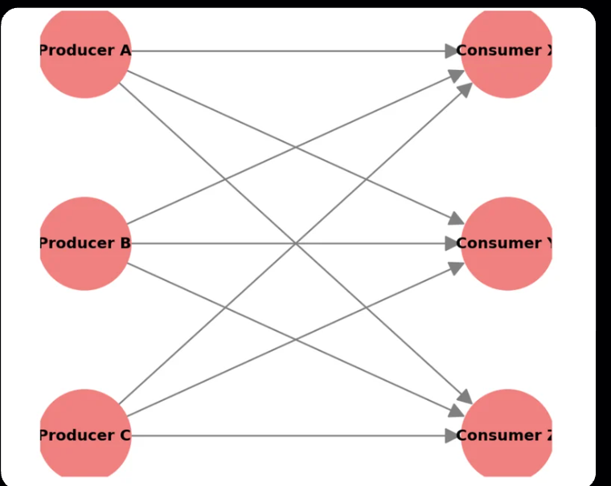
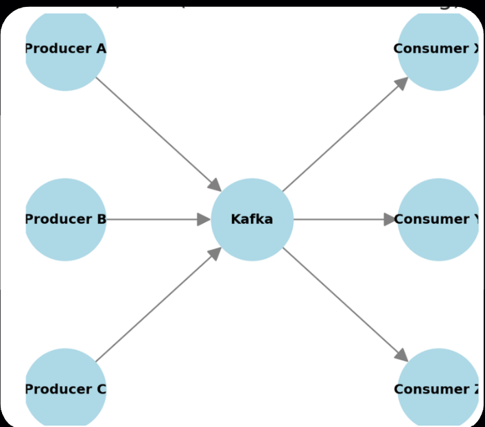
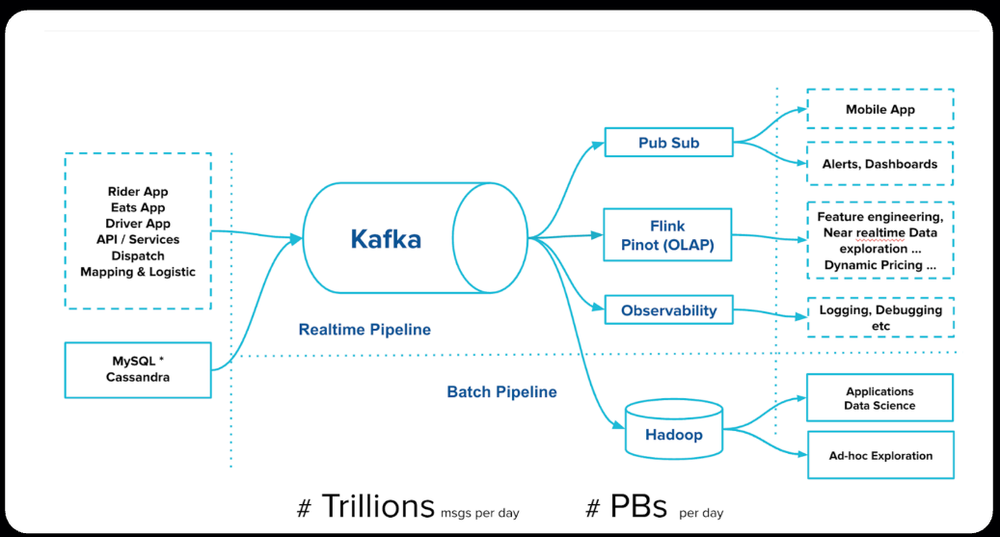

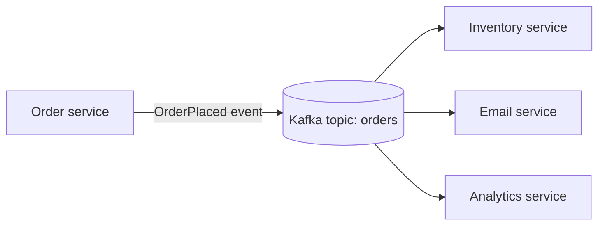

Kafka is the event transport and durable event log in this design. It does not automatically make services correct: each consumer still needs to handle retries, duplicate processing, failures, and changes to event formats.

## How Kafka works

1. A **producer** creates a record and sends it to a topic.
2. Kafka assigns the record to a partition (often using its key), then appends it to that partition's log.
3. Kafka returns the record's partition and offset to the producer.
4. A **consumer** fetches records from its assigned partitions and processes them.
5. The consumer periodically commits its offsets so it can resume after a restart.

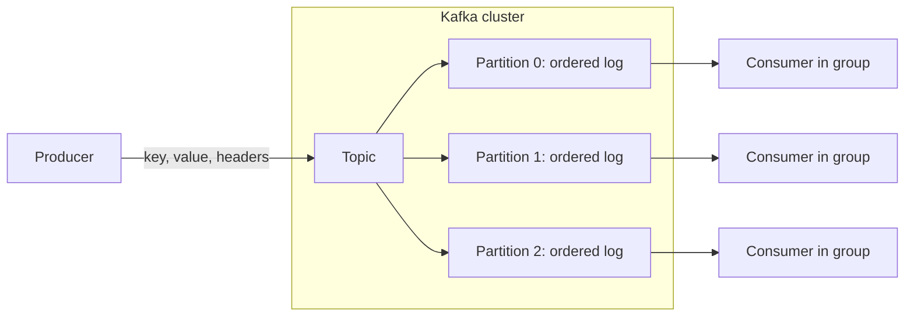

Kafka stores records for a configured retention period or according to a topic's compaction policy. Reading a record does **not** normally remove it; another consumer group can read the same retained records independently.

## Core concepts

| Concept | What it means | Why it matters |
|---|---|---|
| **Record (message/event)** | A value plus optional key, timestamp, and headers. | The unit producers write and consumers read. |
| **Topic** | A named stream of related records, such as `orders`. | Separates event types and provides topic-level retention and configuration. |
| **Partition** | An ordered, append-only log within a topic. | Enables parallelism and distributes data across brokers. |
| **Offset** | The position of a record within one partition. | Lets a consumer track where it should resume. |
| **Broker** | A Kafka server that stores and serves partition replicas. | Brokers work together as a cluster. |
| **Producer** | An application that writes records. | Chooses a topic and can use keys, acknowledgments, and retries. |
| **Consumer** | An application that reads records. | Processes records and tracks its progress. |
| **Consumer group** | Consumers sharing one group ID and dividing topic partitions. | Scales work while each partition is assigned to at most one consumer in that group at a time. |
| **Replication** | Copies of a partition stored on multiple brokers. | Helps keep data available if a broker fails. |

### Topics, partitions, and offsets

A topic is split into partitions. Each partition is an ordered log, and each record receives an offset within that partition. Offsets are **not global topic numbers**: partition 0 and partition 1 can both contain an offset 12.

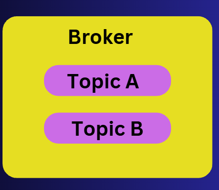

```text
Topic: orders

Partition 0: [offset 0] [offset 1] [offset 2] [offset 3]  --->
Partition 1: [offset 0] [offset 1] [offset 2]            --->
Partition 2: [offset 0] [offset 1] [offset 2] [offset 3] --->
```

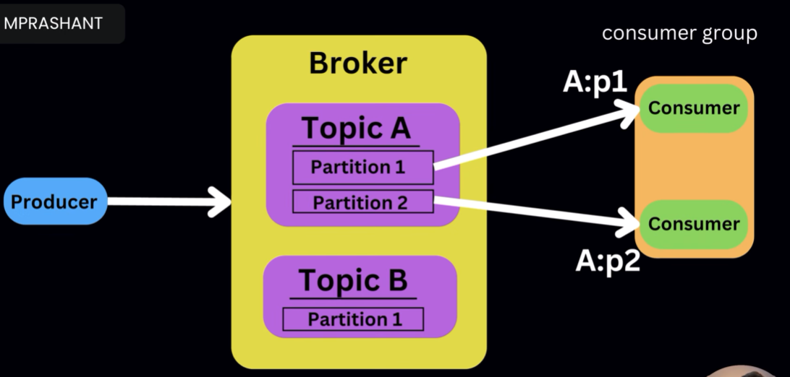
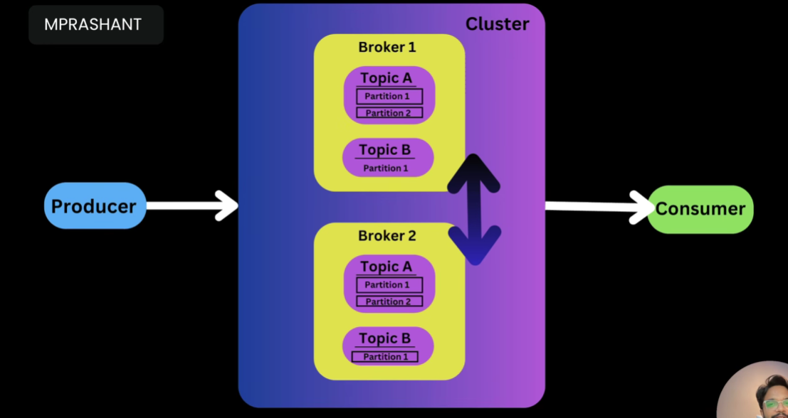

Kafka guarantees record order **within a partition**, not across every partition in a topic. More partitions can increase parallelism, but they also add operational overhead and do not create a single total order.

### Keys and partition selection

A record key is optional. When a key is provided, Kafka's default partitioning generally maps the same key to the same partition. This is useful when related events must be processed in order—for example, all events for `customer-42`.

Without a key, records can be distributed across partitions, so ordering for a particular entity is not assured. A custom partitioner can change the default behavior.

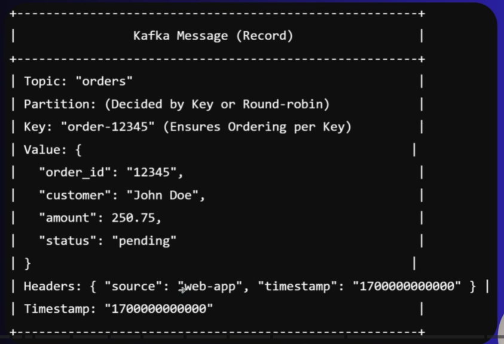

### Brokers, leaders, and replicas

Each partition has a **leader** replica that handles reads and writes, plus zero or more **follower** replicas that copy its data. Replication factor 3 means three copies in total, when the cluster has enough brokers. Kafka can elect a new leader if a broker fails, depending on the replica state and cluster configuration.

For a local, single-broker learning setup, use replication factor 1. This does not provide broker-failure protection.

### Consumer groups and offsets

Consumers with the same `group.id` cooperate: Kafka assigns each partition to one consumer in that group at a time. If there are more consumers than partitions, some consumers will be idle. Different group IDs receive independent views of the topic and can each read the same records.

```text
Topic has 3 partitions            Consumer group: order-workers
Partition 0  -------------------> Consumer A
Partition 1  -------------------> Consumer B
Partition 2  -------------------> Consumer C

An independent group, analytics, can also read all 3 partitions.
```

The committed offset records a group's progress. If a consumer crashes before committing, it may read some records again after restart. If it commits before its work is safely complete, it may skip work after a crash. Offset handling therefore affects delivery behavior.

### Serialization and schemas

Kafka stores record keys and values as bytes. Producers and consumers must agree on how to turn application data into bytes and back—this is **serialization** and **deserialization**. JSON is easy to inspect; formats such as Avro and Protobuf are often used with a schema-management process to evolve event contracts safely.

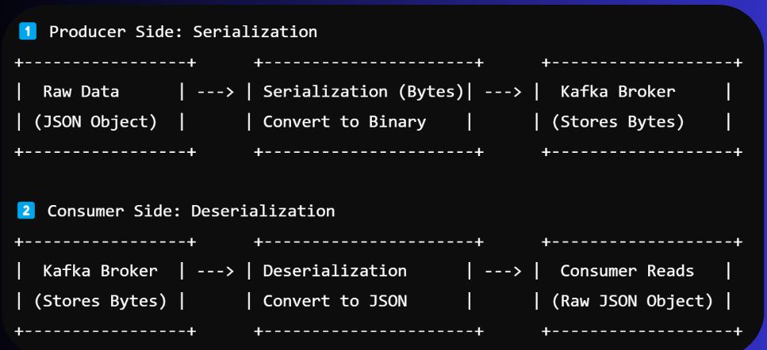
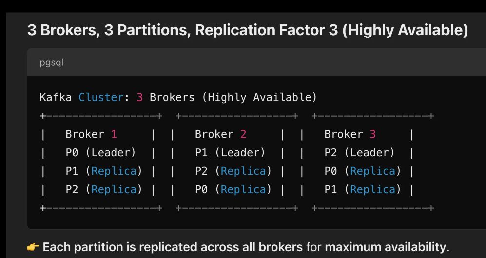

Use descriptive event names and include only fields consumers need. When changing an event schema, consider compatibility with producers and consumers that may be deployed at different times.

## A real-world example

Imagine an online store. When a customer places an order, the order service writes an event such as:

```json
{
  "eventType": "OrderPlaced",
  "orderId": "order-1042",
  "customerId": "customer-42",
  "items": [
    { "sku": "book-7", "quantity": 1 }
  ],
  "total": 24.99
}
```

The producer can use `order-1042` as the key. A topic named `orders` stores the event, and separate consumer groups react:

| Consumer group | Action |
|---|---|
| `inventory-service` | Reserve the ordered items. |
| `email-service` | Send an order confirmation. |
| `analytics-service` | Update sales dashboards. |

If the email service is temporarily unavailable, the order service does not have to wait for it. The email consumer can recover and continue from its committed offset, as long as the event is still retained. Consumers should be idempotent—processing the same event twice should not charge a customer twice or reserve inventory twice.

## Kafka compared with a traditional message queue

This is a general comparison; exact behavior depends on the specific broker and its configuration.

| Area | Kafka | Traditional queue (typical pattern) |
|---|---|---|
| Primary model | Retained, partitioned event log | Messages are commonly delivered to a queue for processing |
| After consumption | Records remain until retention/compaction removes them | Acknowledged messages are commonly removed |
| Multiple independent readers | Each consumer group can read its own copy of the stream | Often needs separate queues or explicit fan-out for independent readers |
| Ordering | Guaranteed within a partition | Often ordered within a queue, subject to concurrency and broker behavior |
| Scaling | Add partitions and consumers, subject to partition assignment | Add competing consumers; scaling model depends on the queue |
| Common uses | Event streams, replay, analytics, data integration | Task distribution, work queues, request/reply messaging |

Kafka is not automatically the best choice for every asynchronous task. A queue can be simpler when the main requirement is distributing individual jobs to workers and removing them after successful acknowledgment.

## Advantages and trade-offs

### Advantages

- **Decoupling:** Producers do not need direct connections to every consumer.
- **Replay:** Consumers can reread retained events by resetting their offsets.
- **Scalability:** Partitions allow work and storage to be distributed.
- **Multiple consumers:** Independent groups can use the same event stream for different purposes.
- **Durability options:** Replication and producer acknowledgments can reduce the risk of losing acknowledged records.
- **Ecosystem:** Kafka Connect and stream-processing libraries help integrate and transform data.

### Trade-offs

- **Operational complexity:** Production clusters need monitoring, capacity planning, upgrades, security, and careful configuration.
- **Partition trade-offs:** Partition count affects ordering, parallelism, resource use, and future operations.
- **At-least-once duplicates:** Retries and crashes can result in repeated processing unless the workflow is designed for it.
- **Not a database:** Kafka is not a replacement for querying current application state or enforcing relational constraints.
- **Event evolution:** Producers and consumers must coordinate compatible schemas and semantics.
- **Latency and cost:** Kafka may be excessive for low-volume, simple background jobs.

## Delivery, ordering, and reliability

“Exactly once” is not a blanket guarantee for an entire application. Kafka provides features such as idempotent producers and transactions, but end-to-end exactly-once effects also depend on how the consumer handles its output and commits progress.

| Desired behavior | Practical approach |
|---|---|
| Preserve order for one entity | Use a stable key so that entity's records go to the same partition. |
| Avoid losing acknowledged writes | Configure producer acknowledgments and replication appropriately for the cluster. |
| Recover after consumer restart | Commit offsets only when the corresponding processing is safely complete. |
| Handle retries safely | Make processing idempotent, for example by recording processed event IDs. |
| Scale consumers | Increase partition count as needed, then add consumers up to the number of assigned partitions. |

For important workflows, decide explicitly how to handle retries, poison messages, duplicate events, and failures between processing a record and committing its offset.

## Kafka ecosystem

### KRaft and ZooKeeper

Older Kafka deployments used Apache ZooKeeper for cluster metadata and coordination. Modern Kafka supports **KRaft**, which uses Kafka's own Raft-based metadata quorum instead. For a new local setup, use the KRaft configuration shipped with your Kafka distribution; do not start ZooKeeper for that setup.

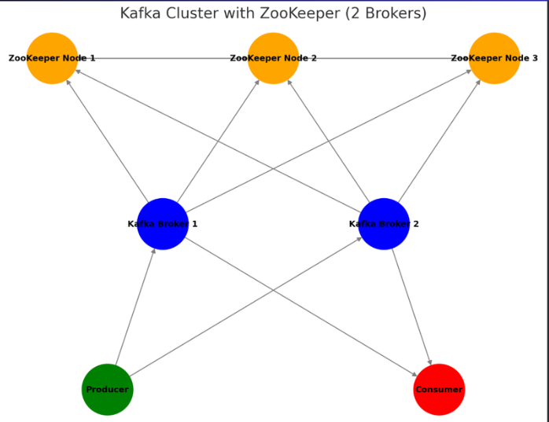
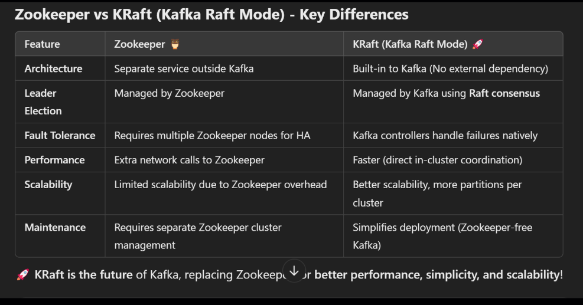

| | ZooKeeper mode | KRaft mode |
|---|---|---|
| Coordination | Separate ZooKeeper service | Kafka's built-in metadata quorum |
| New deployments | Legacy setup; follow the documentation for that Kafka version | Preferred for current Kafka versions |
| Startup | ZooKeeper and Kafka are started separately | Kafka is started with a KRaft configuration |

### Kafka Connect

Kafka Connect is a framework for moving data between Kafka and external systems using reusable **source** and **sink** connectors. A source connector imports data into Kafka; a sink connector exports Kafka data to another system. It reduces the need to write and operate custom data-transfer applications.

### Kafka UI

Kafka UI tools can help inspect brokers, topics, partitions, consumer groups, and records during development. They are administrative clients, not required components of Kafka itself. In Docker, ensure the UI container can reach the broker's advertised address.

## Run Kafka locally on Windows

The following commands assume a Kafka distribution is extracted and the terminal is opened at its root directory. Kafka versions can differ; consult the configuration files and documentation bundled with your version if a path or option differs.

### 1. Format storage for KRaft

Run this once for a **new, empty** local data directory. Keep the generated ID and use it in the format command:

```powershell
.\bin\windows\kafka-storage.bat random-uuid
```

Replace `CLUSTER_ID_FROM_PREVIOUS_COMMAND` below with the ID printed by the previous command:

```powershell
.\bin\windows\kafka-storage.bat format -t CLUSTER_ID_FROM_PREVIOUS_COMMAND -c .\config\kraft\server.properties
```

Do not format an existing cluster's data directory as a troubleshooting shortcut. Formatting or deleting Kafka storage can destroy local data.

### 2. Start the Kafka broker

Open a second terminal at the Kafka distribution root and run:

```powershell
.\bin\windows\kafka-server-start.bat .\config\kraft\server.properties
```

Keep this terminal open while using the broker. The bundled local configuration is for learning and is not a production security or availability setup.

### 3. Create and inspect a topic

In another terminal:

```powershell
.\bin\windows\kafka-topics.bat --bootstrap-server localhost:9092 --create --topic orders --partitions 3 --replication-factor 1
.\bin\windows\kafka-topics.bat --bootstrap-server localhost:9092 --list
.\bin\windows\kafka-topics.bat --bootstrap-server localhost:9092 --describe --topic orders
```

The replication factor is 1 because the local setup has one broker. A multi-broker cluster is needed to demonstrate replication and broker-failure tolerance.

### 4. Produce records with keys

Start the console producer:

```powershell
.\bin\windows\kafka-console-producer.bat --bootstrap-server localhost:9092 --topic orders --property parse.key=true --property key.separator=:
```

Enter one `key:value` record per line:

```text
order-1042:{"eventType":"OrderPlaced","orderId":"order-1042"}
order-1043:{"eventType":"OrderPlaced","orderId":"order-1043"}
```

The text before the first colon is the key; the remaining text is the value. Press `Ctrl+C` to stop the producer.

### 5. Consume records

In a separate terminal, use a new group and read existing records:

```powershell
.\bin\windows\kafka-console-consumer.bat --bootstrap-server localhost:9092 --topic orders --group order-workers --from-beginning --property print.key=true --property key.separator=:
```

Run the same command in a second terminal to see how consumers in the same group share partitions. Use a different group ID to independently read the topic.

### Optional: ZooKeeper mode

Only use ZooKeeper startup commands when working with a Kafka release and configuration that explicitly uses ZooKeeper. The KRaft steps above do not need ZooKeeper. Kafka command names, configuration paths, and mode support vary across releases.

## Useful commands

Run these from the Kafka distribution root in PowerShell:

```powershell
# List topics
.\bin\windows\kafka-topics.bat --bootstrap-server localhost:9092 --list

# Describe a topic, including its partitions and replicas
.\bin\windows\kafka-topics.bat --bootstrap-server localhost:9092 --describe --topic orders

# List consumer groups
.\bin\windows\kafka-consumer-groups.bat --bootstrap-server localhost:9092 --list

# Inspect a group's partition assignments and committed offsets
.\bin\windows\kafka-consumer-groups.bat --bootstrap-server localhost:9092 --describe --group order-workers
```

The equivalent scripts for Linux and macOS are generally under `bin` and end in `.sh` rather than being under `bin\windows` and ending in `.bat`.

## Common pitfalls

- **Using `localhost` from another machine:** `localhost` means the machine or container running the client. Configure Kafka's listener and `advertised.listeners` so clients can reach the broker at the address Kafka advertises.
- **Advertising an unreachable address:** A client may connect to the bootstrap server but fail afterward if the broker advertises an address the client cannot resolve or reach. Do not expose the KRaft controller listener as a client endpoint.
- **Expecting order across partitions:** Kafka orders records within one partition. Use a consistent key when per-entity ordering matters.
- **Expecting more consumers to always increase throughput:** Within one group, useful parallelism is limited by the number of assigned partitions.
- **Assuming a read deletes a record:** Kafka retains records according to topic policy; consumer offsets track progress separately.
- **Using replication factor 3 on one broker:** Topic creation fails if the cluster does not have enough brokers.
- **Reformatting or deleting storage casually:** Local Kafka data lives in configured log directories. Stop the broker and understand the consequences before removing data.
