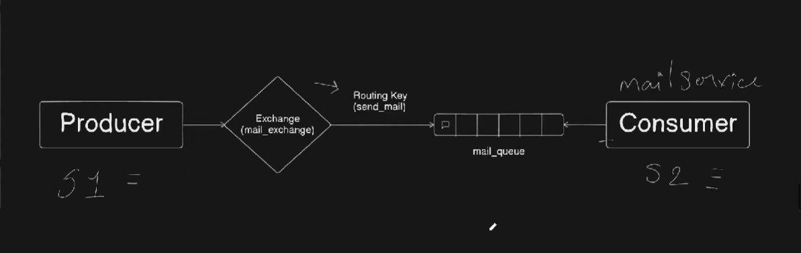

# RabbitMQ: Code and Message Flow



This guide explains the diagram and the current code in `producer.js` and `Consumer.js`, in execution order.

## Follow the diagram

```text
producer.js
    |
    | publish(message, "send_mail")
    v
mail_exchange (direct exchange)
    |
    | binding key "send_mail" matches routing key "send_mail"
    v
mail_queue
    |
    | consume, process, acknowledge
    v
Consumer.js
```

The producer does not send directly to the consumer. It sends a message to the exchange. RabbitMQ routes that message to a bound queue. The consumer reads from the queue.

## `producer.js`: sending a message

### 1. Load the RabbitMQ library

```js
const amqp = require("amqplib");
```

Loads `amqplib`, the Node.js library used to connect to RabbitMQ and work with channels.

### 2. Define the producer function

```js
async function sendMail() {
  try {
```

Defines an asynchronous function so it can `await` the connection, channel, and RabbitMQ setup operations. The `try` block handles errors thrown while setting those up or publishing.

### 3. Connect to RabbitMQ

```js
const connection = await amqp.connect("amqp://localhost");
```

Connects to the RabbitMQ broker on this computer using the default AMQP port, `5672`. In the diagram, this is the connection from the producer application to RabbitMQ.

### 4. Create a channel

```js
const channel = await connection.createChannel();
```

Creates a channel over the connection. Exchanges, queues, bindings, publishing, and consuming operations are performed through a channel.

### 5. Set the exchange and routing key names

```js
const exchange = "mail_exchange";
const routingKey = "send_mail";
```

- `exchange` is the name shown inside the diamond in the diagram.
- `routingKey` is the label RabbitMQ uses to route this message from the exchange to a matching queue binding.

### 6. Build the message

```js
const message = {
  to: "rahul@gmail.com",
  from: "harish@gmail.com",
  subject: "Hello TP mail",
  body: "Hello KAKA!!"
};
```

This is the JavaScript object the producer wants to send. It is the payload that will eventually be read by the consumer.

### 7. Declare the exchange

```js
await channel.assertExchange(exchange, "direct", { durable: false });
```

Ensures that `mail_exchange` exists and is a `direct` exchange. A direct exchange routes a message when its routing key exactly matches a queue's binding key.

Here, `durable: false` means the exchange is not intended to survive a RabbitMQ broker restart. The producer and consumer do not declare the exchange with different settings, so this is not the queue durability mismatch that caused the 406 error.

### 8. Declare the queue

```js
await channel.assertQueue("mail_queue", { durable: true });
```

Ensures the named `mail_queue` exists. The consumer uses the same queue name and the same `durable: true` setting.

`durable: true` means RabbitMQ keeps the queue definition through a broker restart. It does not by itself guarantee that messages survive a restart; the exchange and published messages also need appropriate durability/persistence settings.

### 9. Bind the queue to the exchange

```js
await channel.bindQueue("mail_queue", exchange, routingKey);
```

Creates the route shown by the arrow between the exchange and queue in the diagram. It says: send messages from `mail_exchange` to `mail_queue` when their routing key is `send_mail`.

### 10. Serialize and publish the message

```js
channel.publish(
  exchange,
  routingKey,
  Buffer.from(JSON.stringify(message))
);
```

`JSON.stringify(message)` converts the JavaScript object to JSON text. `Buffer.from(...)` converts that text to bytes, which is the form RabbitMQ transports.

`channel.publish(...)` sends the bytes to `mail_exchange` with the `send_mail` routing key. RabbitMQ matches that key against the binding and routes the message to `mail_queue`.

### 11. Log and close the connection

```js
console.log("Mail data was sent", message);

setTimeout(() => {
  connection.close();
}, 500);
```

The log displays the object in the producer's terminal. The timeout gives the asynchronous publish operation a short time before closing the connection. The consumer's receive log is the confirmation that it actually read a message from the queue.

### 12. Handle setup errors and start the function

```js
} catch (error) {
  console.log(error);
}
}

sendMail();
```

The `catch` logs an error if an awaited setup operation fails. The final call starts the producer function.

## `Consumer.js`: receiving a message

### 1. Load the library and define the consumer function

```js
const amqp = require("amqplib");

async function recvMail() {
  try {
```

Loads the same RabbitMQ library and defines an asynchronous function for connecting and setting up the consumer.

### 2. Connect and create a channel

```js
const connection = await amqp.connect("amqp://localhost");
const channel = await connection.createChannel();
```

Connects to the same RabbitMQ broker as the producer, then creates a channel for queue operations.

### 3. Ensure the same queue exists

```js
await channel.assertQueue("mail_queue", { durable: true });
```

The consumer declares the exact queue used by the producer, with the same durability setting. RabbitMQ compares the declaration with the existing queue; the name and options must agree.

### 4. Start consuming

```js
channel.consume("mail_queue", (message) => {
```

Registers a callback that RabbitMQ invokes when a message is delivered from `mail_queue`. The consumer remains active, waiting for messages.

### 5. Check, decode, and display each message

```js
if (message !== null) {
  console.log("Recv message ", JSON.parse(message.content));
```

RabbitMQ can call the callback with `null` when the consumer is cancelled. Otherwise, `message.content` contains the bytes published by the producer. `JSON.parse(...)` converts those bytes back into a JavaScript object for display.

### 6. Acknowledge successful processing

```js
channel.ack(message);
```

Tells RabbitMQ that this message was processed. RabbitMQ can then remove it from the queue. Without an acknowledgement, RabbitMQ may deliver it again if the consumer disconnects before processing is confirmed.

### 7. Handle setup errors and start the consumer

```js
} catch (error) {
  console.log(error);
}
}

recvMail();
```

The `catch` logs errors from the awaited connection, channel, or queue setup. Calling `recvMail()` starts the consumer. Run this script in a terminal and leave it running while you run the producer in another terminal.

## Run the workflow

Start RabbitMQ if it is not already running:

```powershell
docker run -d --name rabbitmq -p 5672:5672 -p 15672:15672 rabbitmq:management
```

Start the consumer in one terminal:

```powershell
node .\Consumer.js
```

Publish a message from another terminal:

```powershell
node .\producer.js
```

The producer prints `Mail data was sent`. The consumer should print `Recv message` with the decoded mail object.

## Why the two errors occurred

- **541 `transient_nonexcl_queues`:** the original producer attempted to create a named queue with `durable: false`. The RabbitMQ server rejected this transient, non-exclusive queue feature. The producer now declares the queue as durable.
- **406 `PRECONDITION_FAILED`:** after the producer created `mail_queue` as durable, the consumer still declared it as non-durable. RabbitMQ rejected the conflicting declaration. Both scripts now use `durable: true`.

In short, producer and consumer must agree on the queue name and its declaration options.
