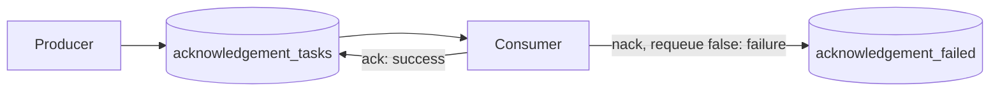

# RQ10: Acknowledgements, Rejects, and Dead-Letter Queues

With **manual acknowledgements**, RabbitMQ keeps a delivered message until the
consumer confirms success. If a consumer disconnects before acknowledging,
RabbitMQ can requeue the unacknowledged message for another delivery.



## What the acknowledgements mean

- `channel.ack(message)`: processing succeeded; remove this delivery from the
  queue.
- `channel.nack(message, false, true)`: reject and requeue the message. Use
  carefully: a persistent error can create an infinite redelivery loop.
- `channel.nack(message, false, false)` or `channel.reject(message, false)`:
  reject without requeue. If the source queue has a dead-letter exchange, the
  broker routes the message there; otherwise, it is discarded.
- `noAck: true`: automatic acknowledgement on delivery. Avoid this for work
  that must not be lost if the consumer crashes during processing.

Acknowledgements apply to deliveries, not to an application-wide transaction.
Design handlers to be idempotent because a crash after a side effect but before
the acknowledgement can result in redelivery.

## Example files

- [`producer.js`](./producer.js) publishes three persistent tasks, including
  one intentionally marked to fail.
- [`consumer.js`](./consumer.js) acknowledges successful tasks and rejects the
  example failure without requeue.

The source queue is configured with a dead-letter route to
`acknowledgement_failed`, so the failing task is preserved for inspection.
This uses RabbitMQ's default exchange to route to a queue with the same name.

## Run it

From this folder, install the declared dependency once with `npm install`.
Start RabbitMQ at `amqp://localhost`, then use two terminals:

```sh
npm run consumer
npm run producer
```

The consumer should acknowledge the successful tasks and route the failing one
to the dead-letter queue. Inspect the latter in the RabbitMQ management UI or
with `rabbitmqadmin`.

## Why and when to use it

Use manual acknowledgements when successful processing must be distinguished
from merely receiving a message. Combine rejection with a dead-letter
exchange/queue when failed messages need investigation, retry, or later
reprocessing.

## Real-life use case

A document-processing worker acknowledges a job after the file is validated
and stored. If validation fails permanently, it rejects the job to a
dead-letter queue so an operator can diagnose it without blocking healthy
jobs.

## Advantages

- Prevents RabbitMQ from treating a message as complete before the consumer
  finishes its work.
- Unacknowledged messages can be redelivered after a consumer failure.
- Dead-letter routing gives failed or expired messages a separate destination.

## Disadvantages and trade-offs

- Redelivery can repeat work; handlers and external side effects should be
  idempotent.
- Requeueing a permanently failing message can cause a tight retry loop.
- Acknowledging too early can lose work; acknowledging too late can cause
  unnecessary redelivery.
- Dead-letter queues need their own monitoring, retention, and replay policies.
