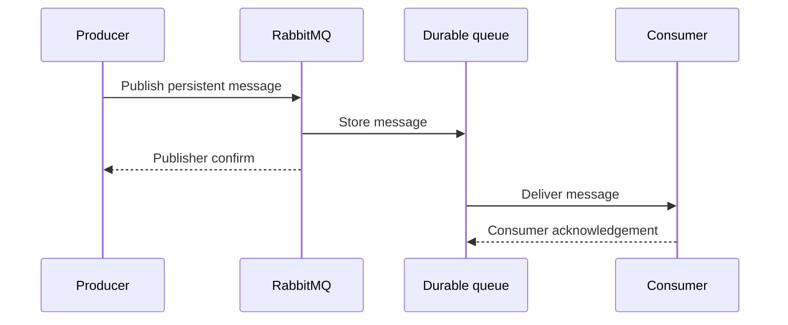

# RQ12: Durable Queues, Persistent Messages, and Publisher Confirms

Durability involves several separate guarantees:

1. A **durable queue** stores its queue definition across broker restarts.
2. A **persistent message** (`deliveryMode: 2`, or `persistent: true` in
   amqplib) asks RabbitMQ to persist the message.
3. A **publisher confirm** lets the producer know the broker accepted the
   publish. It is not the same as a consumer acknowledgement.



Together these mechanisms improve reliability, but do not by themselves
provide exactly-once processing. Broker replication, storage, and application
idempotency still matter.

## Example files

- [`producer.js`](./producer.js) declares a durable queue, publishes a
  persistent job on a confirm channel, and waits for `waitForConfirms()`.
- [`consumer.js`](./consumer.js) consumes with manual acknowledgement.

Both programs declare `durable_jobs` with the same settings. The producer uses
`sendToQueue`, so the target queue is explicit.

## Run it

Run `npm install` from this folder and start RabbitMQ at `amqp://localhost`.
Start the consumer, then publish a job:

```sh
npm run consumer
npm run producer
```

The producer logs only after the broker confirms its publish. The consumer
logs after receiving the job and acknowledges it.

## What confirms do and do not mean

A confirm indicates the broker accepted responsibility for the publish under
the broker's configured durability/replication behavior. It does not mean a
consumer processed the message. Conversely, a consumer acknowledgement tells
the broker a particular delivery was processed; it does not confirm the
producer's original publish.

This example targets a named queue. When publishing to an exchange instead,
use `mandatory: true` and handle returned messages if an unroutable publish
must be detected; a publisher confirm alone does not guarantee that a message
was routed to a queue.

## Why and when to use it

Use durable queues and persistent messages for work that should survive a
broker restart. Use publisher confirms when the publishing application needs
to detect broker-side acceptance rather than treating a local `publish()`
call as proof of delivery.

## Real-life use case

A payment service publishes a durable payment-verification job. It waits for a
broker confirm before marking the event as safely handed off, while a worker
acknowledges only after processing the job.

## Advantages

- Separates the queue's restart behavior from message persistence.
- Confirms let publishers detect broker acceptance and handle failures.
- Consumer acknowledgements keep unprocessed work available for redelivery.

## Disadvantages and trade-offs

- Persistence and confirms add disk or replication work and can affect
  throughput and latency.
- Queue durability alone does not make transient messages persistent.
- Persistent delivery alone does not prove that the broker accepted a publish;
  wait for confirms.
- Retries after uncertain connection failures can duplicate messages; use
  stable identifiers and idempotent processing.
- Exactly-once business effects require application-level design.
