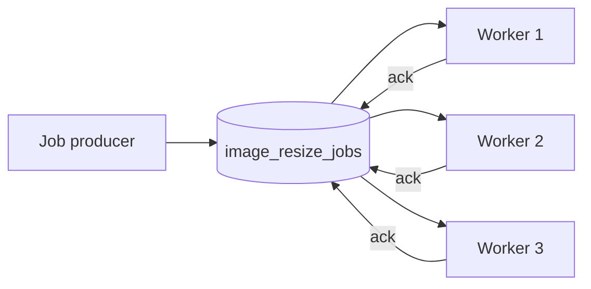

# RQ13: Competing Consumers and Worker Scaling

With **competing consumers**, multiple workers consume from the same queue.
RabbitMQ distributes deliveries among available consumers; each message is
normally handled by one worker, not broadcast to all of them.



The queue is the shared work backlog. Each worker acknowledges only after its
job succeeds, and `prefetch(1)` prevents a worker from holding more than one
unacknowledged job at a time.

## Example files

- [`producer.js`](./producer.js) publishes 12 image-resize jobs.
- [`worker.js`](./worker.js) consumes jobs and simulates work. Its optional
  command-line argument gives the worker a display name.

## Run it

Install dependencies with `npm install` in this folder. Start RabbitMQ at
`amqp://localhost`, then open three terminals and start workers:

```sh
npm run worker -- worker-A
npm run worker -- worker-B
npm run worker -- worker-C
```

In another terminal, publish the jobs:

```sh
npm run producer
```

Watch the worker logs to see jobs distributed across the processes. Delivery
order among workers is not guaranteed.

## Why and when to use it

Use competing consumers to scale a queue-based workload horizontally. Add
workers when the backlog grows and remove them when demand falls, while keeping
the producer independent of the worker count.

## Real-life use case

An image service queues resize jobs after users upload photos. Several worker
instances pull from the same queue, allowing the service to process more
uploads in parallel without changing the upload API.

## Advantages

- Increases processing capacity by adding workers.
- Acknowledgements allow unfinished work to be redelivered after worker
  failure.
- Producers do not need to know which worker handles each task.
- `prefetch` helps avoid giving one slow worker an excessive backlog.

## Disadvantages and trade-offs

- Workers should be stateless or coordinate shared state safely.
- Work may be delivered again after failure; processing should be idempotent.
- Adding workers does not guarantee strict ordering.
- A slow or poison message can be retried repeatedly unless retry/dead-letter
  policies are configured.
- Database, API, or CPU bottlenecks can limit the benefit of adding workers.
