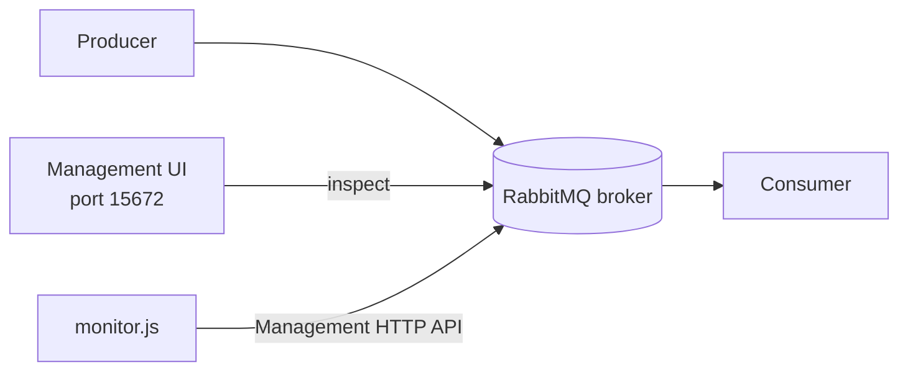

# RQ14: Monitoring and Management

RabbitMQ monitoring helps answer operational questions: Is the broker up?
Are queues accumulating messages? Are consumers connected? Are messages stuck
unacknowledged? The **Management plugin** provides a browser UI and HTTP API
for inspecting brokers, connections, channels, exchanges, queues, and rates.



The AMQP protocol uses port `5672`; the management UI/API uses port `15672`.
They are separate interfaces.

## Example files

- [`docker-compose.yml`](./docker-compose.yml) starts a local RabbitMQ
  management image.
- [`monitor.js`](./monitor.js) queries the HTTP API for broker overview and
  queue counts, then prints ready, unacknowledged, and consumer totals.

## Run it

Start the local broker from this folder:

```sh
docker compose up -d
```

Open the management UI at `http://localhost:15672`. The official local
development image defaults to `guest` / `guest`; do not use default credentials
for a network-accessible production broker.

Run the API report with Node.js 18 or newer:

```sh
node monitor.js
```

For different credentials or a remote management endpoint, provide environment
variables instead of editing the script:

```powershell
$env:RABBITMQ_MANAGEMENT_URL = "http://localhost:15672"
$env:RABBITMQ_USER = "guest"
$env:RABBITMQ_PASSWORD = "guest"
node .\monitor.js
```

The account used by the script needs permission to read the management API.
Stop the local broker with `docker compose down`.

## What to monitor

- **Ready messages:** waiting to be delivered. A sustained increase can mean
  the producer outpaces consumers.
- **Unacknowledged messages:** delivered but not yet acknowledged. A large
  number can indicate slow processing, insufficient prefetch control, or
  stalled consumers.
- **Consumer count:** workers currently subscribed to a queue.
- **Publish/delivery/ack rates:** help reveal throughput and processing
  bottlenecks.
- **Connections, channels, memory, disk, and node health:** help identify
  resource limits and broker availability problems.

Counts are snapshots; use trends, alerts, and workload context rather than
reacting to a single sample.

## Why and when to use it

Use management tools during development to inspect topology and verify message
flow. In production, monitor queue depth, consumer health, message rates,
resource alarms, and broker availability; configure authentication and network
access according to your security requirements.

## Real-life use case

An operations dashboard alerts when a payment queue's ready-message count
keeps rising while its consumer count drops to zero. The team can investigate
worker health before the backlog affects customer payments.

## Advantages

- Provides a visual way to inspect queues, bindings, consumers, and broker
  state.
- The HTTP API supports scripts, dashboards, and automated checks.
- Queue depth and consumer metrics help locate bottlenecks.

## Disadvantages and trade-offs

- Metrics and management endpoints need appropriate access controls; exposing
  them publicly or using default credentials is unsafe.
- Management data is operational telemetry, not a substitute for application
  logs, tracing, or business-level monitoring.
- Polling too frequently or collecting excessive detail can add overhead.
- A snapshot alone does not explain why a queue is growing; correlate with
  producer, consumer, and broker metrics over time.
