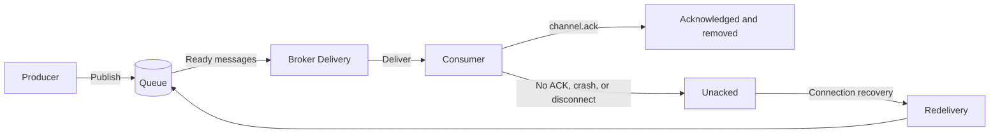
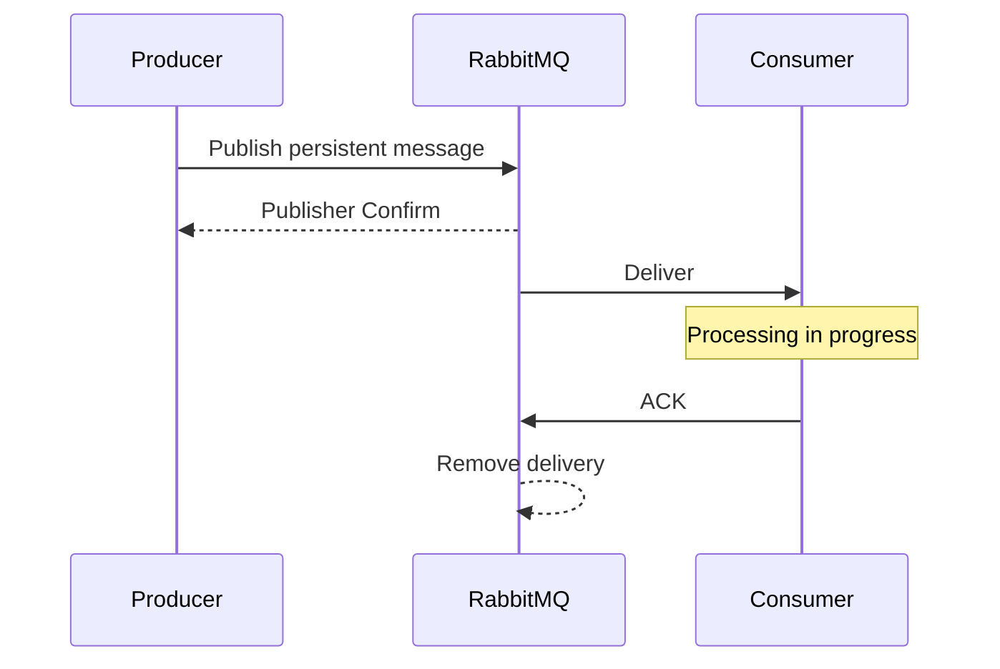

# RQ15: Ready vs Unacked vs ACK

## সংক্ষিপ্ত পরিচয়

RabbitMQ-তে একটি queue message-কে অবস্থাভেদে তিনটি গুরুত্বপূর্ণ রূপে গণনা করে:

| State | অর্থ | ACK লাগে কি? |
|---|---|---|
| **Ready** | Queue-তে আছে, কিন্তু কোনো consumer-কে এখনো deliver হয়নি | না |
| **Unacked** | Consumer-কে deliver হয়েছে, কিন্তু manual ACK আসেনি | না/অপেক্ষা করছে |
| **ACKed / Removed** | Consumer সফল processing-এর পর ACK পাঠিয়েছে এবং broker remove করেছে | হ্যাঁ |

এই lesson একটি live producer, manual ACK consumer এবং Management API monitor দিয়ে এই তিনটি state দেখায়।



## ফাইলগুলোর ভূমিকা

- `producer.js` 12টি persistent ও confirm-checked task publish করে।
- `consumer.js` configurable prefetch, processing delay এবং manual/automatic ACK mode দেখায়।
- `monitor.js` প্রতি second queue-এর Ready, Unacked, total এবং consumer count print করে।
- `docker-compose.yml` RabbitMQ এবং Management UI চালু করে।

## Ready কী?

Message broker queue-তে পৌঁছেছে, কিন্তু এখনো কোনো consumer-কে delivered হয়নি।

```text
Ready = 12
Unacked = 0
```

এই state-এর সাধারণ কারণ:

- কোনো consumer connected নেই।
- Worker busy এবং delivery capacity নেই।
- Consumer prefetch limit reached।
- Publisher worker-এর চেয়ে দ্রুত publish করছে।
- Slow processing-এর কারণে backlog হয়েছে।

Ready বেশি হওয়ার মূল সমস্যা সাধারণত producer throughput এবং consumer throughput-এর মধ্যে imbalance।

## Unacked কী?

Broker message consumer-কে পাঠিয়েছে, কিন্তু consumer success-এর confirmation পাঠায়নি। এটি **Unacked** count বৃদ্ধি করে।

```text
Ready = 9
Unacked = 3
```

এখানে তিনটি message:

- Consumer-কে delivered হয়েছে।
- Processing চলতে পারে।
- Consumer ACK পাঠায়নি।

Ready এবং Unacked-এর গুরুত্ব:

- **Ready:** broker এখনো delivery করতে পারেনি।
- **Unacked:** delivery হয়েছে, কিন্তু completion confirmation হয়নি।

একটি message crash, network failure বা application error-এর জন্য broker-এর কাছে এখনও active delivery হিসেবে ধরে রাখা হয়।

## ACK কী?

ACK হলো consumer-এর message processing সম্পন্ন হওয়ার confirmation।

```js
channel.ack(message);
```

Manual ACK-এর পরে broker queue থেকে message delivery remove করে।

```text
Before ACK: Ready + Unacked = 12
After ACK:  Ready + Unacked = 11
```

ACK সফল work complete হওয়ার পরেই পাঠাতে হয়। কাজ শুরু হওয়ার শুরুতেই ACK দিলে processing crash হলে message হারাতে পারে।

## Prefetch কীভাবে state নিয়ন্ত্রণ করে?

Prefetch একসঙ্গে consumer-এর হাতে থাকা Unacked message-এর limit নির্ধারণ করে।

```js
await channel.prefetch(3);
```

Consumer-এ 3 prefetch থাকলে broker এক consumer-কে সর্বোচ্চ তিনটি Unacked delivery রাখবে। তিনটি ACK না হওয়া পর্যন্ত নতুন delivery সীমিত হতে পারে।

| Prefetch | সুবিধা | ঝুঁকি |
|---|---|---|
| 1 | Low memory, balanced delivery | কম throughput |
| 3-10 | Moderate throughput | Slow worker backlog |
| খুব বেশি | বেশি throughput সম্ভাবনা | অনেক Unacked message accumulate |

Prefetch tuning-এ consumer processing capacity এবং memory usage দুটিই বিবেচনা করতে হবে।

## Manual ACK

```js
await channel.consume(queueName, handler, { noAck: false });

channel.ack(message);
```

Manual ACK সাধারণত durable background jobs-এর জন্য ব্যবহার করা উচিত।

Processing:

1. Message receive।
2. External task complete।
3. Data persist।
4. ACK।

Database update success হলেও ACK-এ crash হলে broker message redeliver করতে পারে। তাই consumer অবশ্যই **idempotent** হতে হবে।

## Automatic ACK

```js
await channel.consume(queueName, handler, { noAck: true });
```

এই mode-এ broker message delivery moment-এ acknowledgement হিসেবে ধরে নিতে পারে। Processing crash করলে message পুনরায় পাওয়ার guarantee থাকে না।

দ্রুত disposable message বা at-most-once semantics-এর মতো specific use case ছাড়া production jobs-এর জন্য এটা avoid করা ভালো।

## ACK করার সময়

### সঠিক

```js
try {
  await saveToDatabase(task);
  channel.ack(message);
} catch (error) {
  channel.nack(message, false, true);
}
```

### ভুল

```js
channel.ack(message);
await saveToDatabase(task); // ACK আগে, processing পরে
```

Database write fail হলে message হারাতে পারে।

## Consumer crash হলে

Message delivered হলে:

```text
Ready -> Unacked
```

Consumer crash বা connection disconnect হলে ACK না পৌঁছায়। Broker connection loss detect করলে Unacked delivery পুনরায় eligible করে:

```text
Unacked -> Redelivery -> Ready
```

অন্য consumer connected থাকলে redelivered message receive করতে পারে। এটি duplicate processing-এর risk তৈরি করে।

## Producer confirm এবং consumer ACK-এর পার্থক্য

এরা দুটি আলাদা acknowledgment level:

- **Publisher confirm:** broker message receive করেছে।
- **Consumer ACK:** consumer processing complete করেছে।

Publisher confirm = broker delivery reliability।
Consumer ACK = application processing reliability।



## Run করার নিয়ম

### 1. Broker চালু করুন

```powershell
cd "C:\Users\User\Desktop\New folder\New folder\Backend Learning\RabbitMQ\RQ15-Ready_vs_Unacked_vs_ACK"
docker compose up -d
npm install
```

Management UI:

```text
http://localhost:15672
```

### 2. Monitor চালু করুন

```powershell
npm run monitor
```

Output:

```text
ready=12 unacked=0 total=12 consumers=0
ready=9 unacked=3 total=12 consumers=1
ready=0 unacked=0 total=0 consumers=1
```

### 3. Manual ACK consumer চালু করুন

```powershell
$env:PREFETCH = "3"
$env:ACK_DELAY_MS = "4000"
npm run consumer
```

Terminal-এ একটি message receive করার পর 4 second delay থাকবে। এই সময়টি Unacked state observe করার জন্য।

### 4. Producer চালু করুন

```powershell
npm run producer
```

Producer 12টি confirmed task publish করবে।

### 5. Auto ACK পরীক্ষা

```powershell
$env:AUTO_ACK = "true"
npm run consumer
```

Auto ACK test শেষ হলে environment remove করুন:

```powershell
Remove-Item Env:AUTO_ACK
```

## Live experiments

### Experiment 1: Consumer ছাড়াই producer

1. Consumer বন্ধ রাখুন।
2. Producer চালান।
3. `ready≈12`, `unacked=0` দেখুন।

এখন messages consumer waiting অবস্থায় আছে।

### Experiment 2: Processing delay

```powershell
$env:PREFETCH = "3"
$env:ACK_DELAY_MS = "8000"
npm run consumer
```

Producer চালান। 3টি delivered message Unacked থাকবে এবং prefetched limit না হওয়া পর্যন্ত নতুন delivery blocked হতে পারে।

### Experiment 3: Prefetch=1

```powershell
$env:PREFETCH = "1"
$env:ACK_DELAY_MS = "4000"
npm run consumer
```

এই case-এ একবারে এক Unacked message থাকবে।

### Experiment 4: Prefetch=6

```powershell
$env:PREFETCH = "6"
$env:ACK_DELAY_MS = "4000"
npm run consumer
```

একসঙ্গে আরও বেশি Unacked delivery দেখতে পাওয়া যাবে।

### Experiment 5: Consumer crash

1. Manual ACK consumer এবং producer চালান।
2. Processing delay-এর মধ্যে consumer terminal বন্ধ করুন।
3. নতুন consumer চালান।
4. Unacked message redeliver হবে।

## Management UI কী দেখবে?

1. `http://localhost:15672` open করুন।
2. **Queues and Streams** open করুন।
3. `rq15_ready_unacked` select করুন।
4. সংক্ষিপ্ত queue overview-এ দেখুন:

   - **Ready**
   - **Unacked**
   - **Total**
   - **Consumers**

## Ready বেশি হলে কী করবেন?

- Consumer count বাড়ান।
- Worker processing bottleneck analyze করুন।
- External database/API latency test করুন।
- Producer publish rate সীমিত করুন।
- Prefetch tune করুন।
- Queue-specific alert তৈরি করুন।

## Unacked বেশি হলে কী করবেন?

- ACK delay বাড়ে কি না inspect করুন।
- Prefetch ছোট করুন।
- Consumer logs ও crash report দেখুন।
- External API timeout যুক্ত করুন।
- Hung worker detect ও restart করুন।
- NACK/requeue এবং dead-letter strategy তৈরি করুন।

## NACK এবং Reject

```js
channel.nack(message, false, true);  // Retry/requeue
channel.nack(message, false, false); // DLQ বা discard
```

Permanent failure infinite retry loop তৈরি করতে পারে। Retry count, backoff এবং Dead-Letter Queue ব্যবহারের জন্য RQ10 এবং RQ11 দেখুন।

## Idempotency

Redelivery-এর কারণে একই message দুবার process হতে পারে।

```text
Database update complete
Consumer crash before ACK
Broker redelivery
Database update repeated
```

সমাধান:

- Stable `messageId` ব্যবহার করুন।
- Database unique constraint/idempotency key রাখুন।
- External API-এর idempotency key ব্যবহার করুন।
- Processing-এর আগে duplicate check করুন।
- Retry result persist করুন।

Producer প্রতিটি task-এ `messageId: rq15-task-<id>` পাঠায়।

## Monitoring formulas

```text
Total ≈ Ready + Unacked
```

Queue backlog rate:

```text
Publish rate - (Delivery + ACK processing rate)
```

Unacked age বা stuck deliveries দেখে slow consumer বা crash detect করা যায়।

## Real-life use cases

### Payment processing

- Ready = paid orders waiting।
- Unacked = payment worker processing চলছে।
- ACK = payment complete এবং ledger update হয়েছে।

### Image processing

- Ready = resize jobs waiting।
- Unacked = worker cloud storage/upload করছে।
- ACK = image processing complete।

### Email delivery

- Ready = emails waiting।
- Unacked = SMTP API call চলছে।
- ACK = email provider accepted কাজ।

## Advantages

- Queue backlog এবং consumer processing bottleneck আলাদাভাবে দেখা যায়।
- Manual ACK reliable processing নিশ্চিত করতে সাহায্য করে।
- Prefetch worker load সীমিত করে।
- Redelivery crash tolerance দেয়।
- Management metrics automation ও alerts-এর জন্য useful।

## Disadvantages and trade-offs

- Manual ACK ভুল implementation Unacked pile তৈরি করতে পারে।
- Processing ধীর হলে throughput কমতে পারে।
- Duplicate redelivery থেকে application side-effect রক্ষা করতে হবে।
- Prefetch বেশি হলে memory এবং slow worker risk বাড়ে।
- Prefetch কম হলে throughput কম হতে পারে।
- Ready এবং Unacked count broker snapshot; শুধু একটি snapshot থেকে সব cause বের করা যায় না।

## Production checklist

- Durable queue এবং persistent message।
- Manual ACK after successful processing।
- Prefetch tune করুন।
- Idempotent handler implement করুন।
- Retry, backoff এবং dead-letter queue দিন।
- Ready, Unacked, consumer এবং ACK rate monitor করুন।
- Consumer disconnect এবং crash handling করুন।
- Auto ACK শুধু at-most-once semantics হলে ব্যবহার করুন।

## Cleanup

```powershell
docker compose down
```

Queue dataসহ remove করতে:

```powershell
docker compose down -v
```
