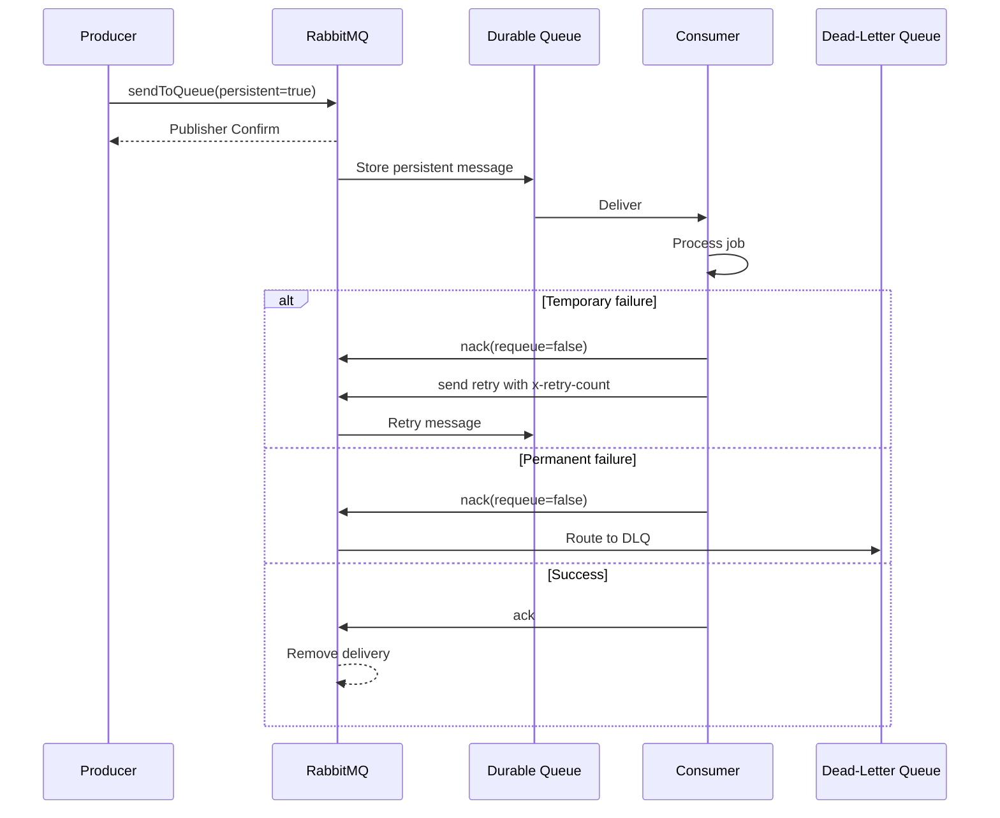

# RQ16: `sendToQueue()`, `nack()`, এবং Persistent Messages

## সংক্ষিপ্ত পরিচয়

এই lesson RabbitMQ reliability-এর তিনটি গুরুত্বপূর্ণ অংশ একসঙ্গে দেখায়:

1. **`sendToQueue()`** দিয়ে named queue-তে message publish করা।
2. **`persistent: true`** দিয়ে broker restart-এর পরও message remain করতে দেওয়া।
3. **`nack()`** দিয়ে temporary এবং permanent failure distinguish করে retry/DLQ behavior পরিচালনা করা।



## ফাইল

- `producer.js` `sendToQueue()` এবং publisher confirms ব্যবহার করে তিনটি persistent job পাঠায়।
- `consumer.js` manual ACK, temporary retry এবং permanent NACK/DLQ demonstrate করে।
- `monitor.js` source queue এবং dead-letter queue-এর Ready/Unacked count দেখায়।
- `docker-compose.yml` local RabbitMQ broker এবং management UI চালায়।

## `sendToQueue()` কী?

`amqplib`-এ named queue-তে সরাসরি publish করার API:

```js
channel.sendToQueue(queueName, Buffer.from(json), options);
```

প্যারামিটার:

- `queueName`: exact queue name।
- `message`: Node.js `Buffer`।
- `options`: persistent mode, content type, message ID, headers ইত্যাদি।

RabbitMQ default exchange-এর routing key হিসাবে queue name ব্যবহার করে।

### উদাহরণ

```js
const message = Buffer.from(
  JSON.stringify({
    id: "job-1",
    action: "generate invoice",
  })
);

channel.sendToQueue("rq16_persistent_jobs", message, {
  persistent: true,
  contentType: "application/json",
  messageId: "job-1",
});
```

## Persistent Message কেন?

`persistent: true` AMQP delivery mode-কে persistent করে:

```js
{
  persistent: true
}
```

Broker restart-এর পরে durable queue-তে persistent message remain করতে চেষ্টা করে।

Important distinction:

| অংশ | নিশ্চিত করে |
|---|---|
| `durable: true` queue | Broker restart-এর পর queue definition remain |
| `persistent: true` message | Broker persist করার চেষ্টা |
| Publisher confirm | Broker publish accept করেছে |
| Consumer ACK | Consumer processing complete করেছে |

Persistent mode পুরোনো queue-এর benefit পায় না। Queue যদি non-durable হয়, broker restart-এর পর queue এবং message দুটোই হারাতে পারে।

## Full Durability Chain

```text
durable queue
+ persistent message
+ publisher confirm
= improved restart reliability
```

এখনও exactly-once delivery guarantee নয়। Producer retry এবং consumer redelivery business duplicate তৈরি করতে পারে। তাই:

- stable `messageId` ব্যবহার করুন।
- database unique key ব্যবহার করুন।
- side effect-idempotency করুন।

## Publisher Confirm

এই example confirm channel ব্যবহার করে:

```js
channel = await connection.createConfirmChannel();
channel.sendToQueue(...);
await channel.waitForConfirms();
```

Confirm-এর অর্থ broker publish accept করেছে। এটি consumer successful processing confirm করে না।

Confirm না পাওয়া গেলে producer retry logic বা explicit error handling উচিত।

## Durable Queue declaration

```js
await channel.assertQueue(QUEUE, {
  durable: true,
  arguments: {
    "x-dead-letter-exchange": "",
    "x-dead-letter-routing-key": DLQ,
  },
});
```

Queue source durable।

`x-dead-letter-*` permanent rejected message-কে DLQ routing দেয়।

## ACK

Processing success হলে:

```js
channel.ack(message);
```

ACK-এর পরে broker delivery remove করে।

Success example:

```text
job-1 received
job-1 processed
ACK
message removed
```

## NACK কী?

`nack()` consumer-কে rejection/delivery failure জানায়:

```js
channel.nack(message, multiple, requeue);
```

Parameters:

| Parameter | অর্থ |
|---|---|
| `message` | বর্তমান delivery |
| `multiple` | এই delivery ছাড়া আগে delivered multiple deliveries ও NACK করবে কি না |
| `requeue` | broker delivery আবার queue-তে requeue করবে কি না |

### Requeue=true

```js
channel.nack(message, false, true);
```

Temporary failure হলে same message আবার queue-তে eligible হয়।

দ্রুত failure হলে infinite retry loop হতে পারে। Production retry-এর জন্য retry limit/backoff ব্যবহার করুন।

### Requeue=false

```js
channel.nack(message, false, false);
```

DLX configured থাকলে permanent reject DLQ-তে route হয়। DLX না থাকলে message discard বা dead-letter behavior broker queue configuration অনুযায়ী হবে।

## এই Example-এর retry design

এই code দুই ধরনের retry strategy দেখায়:

1. প্রথম temporary failure-এ explicit retry message publish।
2. Permanent failure-এ original delivery reject করে DLQ।

```js
if (job.behavior === "fail_once" && retryCount === 0) {
  throw new Error("Temporary processing failure");
}
```

Temporary failure first attempt-এ:

```text
Receive job-2
Throw Temporary processing failure
nack(original, requeue=false)
Publish retry job-2 with x-retry-count=1
```

Retry count next delivery-তে:

```js
headers: {
  "x-retry-count": nextRetryCount,
}
```

Consumer:

```js
const retryCount = Number(
  message.properties.headers?.["x-retry-count"] || 0
);
```

এই retry count application-defined। RabbitMQ automatically delivery count হিসাবে এটি enforce করে না।

## কেন original reject এবং নতুন retry publish?

Example explicit count ও fixed delay দেখানোর জন্য দুটি step ব্যবহার করে:

```js
channel.nack(message, false, false);
channel.sendToQueue(QUEUE, retryBuffer, retryOptions);
```

Production-এ delay exchange বা scheduled retry queue ব্যবহার করা সাধারণ।

সরাসরি `nack(..., true)` ব্যবহার করে immediate redelivery করা যায়, কিন্তু retry count control এবং backoff সরাসরি করা কঠিন।

## Permanent failure

```js
if (job.behavior === "permanent_failure") {
  throw new Error("Permanent validation failure");
}
```

Consumer:

```js
channel.nack(message, false, false);
```

Source queue-এর DLX routing অনুযায়ী:

```text
rq16_persistent_jobs
  -> rq16_persistent_jobs_dlq
```

DLQ operator replay বা debugging-এর জন্য message retain করে।

## Run করণ

### 1. RabbitMQ start

```powershell
cd "C:\Users\User\Desktop\New folder\New folder\Backend Learning\RabbitMQ\RQ16-sendToQueue_nack_Persistent_Messages"
docker compose up -d
npm install
```

### 2. Consumer start

```powershell
npm run consumer
```

### 3. Producer publish

```powershell
npm run producer
```

### 4. Monitor start

```powershell
npm run monitor
```

Management UI:

```text
http://localhost:15672
```

## Expected behavior

Producer:

```text
sendToQueue() submitted persistent job-1
sendToQueue() submitted persistent job-2
sendToQueue() submitted persistent job-3
RabbitMQ confirmed all persistent publishes
```

Consumer:

```text
Processing job-1
ACK: job-1 completed successfully

Processing job-2
NACK requeue=false
Publish retry job-2

Processing job-3
NACK requeue=false
sending to DLQ
```

Source queue শেষে 0–1 retry backlog রেখে empty হতে পারে। DLQ-তে permanent job থাকবে।

## Broker restart test

1. Producer চালিয়ে jobs publish করুন।
2. Consumer চালাবেন না।
3. RabbitMQ container restart করুন:

```powershell
docker compose restart
```

4. Consumer চালান।
5. Persistent messages source queue-তে থাকলে receive হবে।

Queue durable এবং persistent message দুটোই broker restart persistence-এর জন্য জরুরি।

## Management UI inspection

`Queues and Streams` page-এ দেখুন:

- `rq16_persistent_jobs`
- `rq16_persistent_jobs_dlq`

Source queue-এর fields:

- Ready
- Unacked
- Total
- Consumers
- Consumer prefetch

DLQ-তে:

- `job-3` permanent failure message।

## Persistent stream vs ACK

RabbitMQ persistent flag broker storage-এর promise হলেও application data loss পুরোপুরি prevent করে না:

- Disk write pending বা broker replication policy।
- Confirm timeout।
- Consumer crash before ACK।
- ACK after processing side-effect।
- Duplicate retry processing।

At-least-once delivery design করতে manual ACK, retries এবং idempotency ব্যবহার করুন।

## Requeue loop problems

`nack(..., true)` permanent failure-এর জন্য পুনরায় বারবার receive করতে পারে।

Example:

```text
receive -> fail -> nack requeue=true
receive -> fail -> nack requeue=true
repeat forever
```

শুধুমাত্র transient failure এবং retry limit থাকলে requeue/retry ব্যবহার করুন।

এই example:

- temporary `fail_once` only once retry।
- permanent failure সরাসরি DLQ।
- retry count application header-এ।

## Idempotency

Retries duplicate delivery generate করতে পারে।

Safe design:

```js
const processedIds = new Set();

if (processedIds.has(job.id)) {
  channel.ack(message);
  return;
}

await processJob(job);
processedIds.add(job.id);
channel.ack(message);
```

Production-এ in-memory Set শুধু process lifetime-এর জন্য। Persistent solution হতে:

- database unique key।
- payment provider transaction ID।
- outbox/inbox table।
- `messageId` uniqueness constraint।

Producer-generated `messageId: job.id` application-level dedupe key হিসেবে ব্যবহার করা যায়।

## `sendToQueue()` options

| Option | উদাহরণ | ব্যবহার |
|---|---|---|
| `persistent` | `true` | broker disk persistence request |
| `contentType` | `"application/json"` | payload format |
| `messageId` | `"job-1"` | application-level dedupe key |
| `timestamp` | Unix seconds | publish time |
| `headers` | retry count | custom metadata |
| `expiration` | `"30000"` | TTL |
| `priority` | `5` | priority queue |

Options broker behavior বা application metadata বোঝায়। সব option persistence নিশ্চিত করে না।

## Real-life use case

Invoice/payment job:

- Producer durable queue-তে persistent invoice message পাঠায়।
- Temporary supplier outage হলে retry।
- Permanent invalid invoice বা missing customer হলে DLQ।
- Successful invoice processing শেষ হলে ACK।

## Advantages

- Persistent message broker restart resilience বাড়ায়।
- `sendToQueue()` direct named queue publish সহজ করে।
- Publisher confirm publish acceptance নিশ্চিত করে।
- NACK temporary/permanent failure আলাদা করে।
- DLQ bad jobs isolate করে।
- Retry count operator-visible।

## Disadvantages and trade-offs

- Disk persistence throughput এবং latency বাড়া কমাতে পারে।
- Confirm timeout handling দরকার।
- Retry queue complexity বাড়ে।
- Duplicate redelivery application-level solve করতে হয়।
- NACK requeue=true loop তৈরি করতে পারে।
- DLQ monitoring এবং replay policy দরকার।

## Production checklist

- Queue durable declare করুন।
- `persistent: true` sendToQueue options ব্যবহার করুন।
- Confirm channel ও `waitForConfirms()` ব্যবহার করুন।
- Manual ACK ব্যবহার করুন।
- Temporary failure-এর জন্য retry limit/backoff দিন।
- Permanent failure-এ DLQ route দিন।
- Stable `messageId` দিন।
- Idempotent consumer implement করুন।
- Source ও DLQ depth monitor করুন।
- Broker restart ও disk durability strategy test করুন।

## Cleanup

```powershell
docker compose down
```

Persistent queue volumeসহ container remove:

```powershell
docker compose down -v
```
