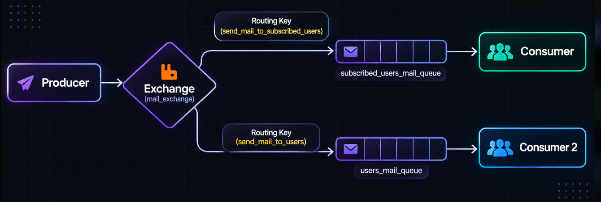

# RQ2: One Producer, One Exchange, Two Queues, Two Consumers

This guide explains the code in `producer.js`, `subConsumer.js`, and `normalConsumer.js`, how messages travel through RabbitMQ, what caused the code errors, and a real-world use case.

## Diagram



```text
                              routing key: send_mail_to_subscribed_users
                           +-------------------------------------------->
                           |             subscribed_users_mail_queue
                           |                        |
producer.js --> mail_exchange (direct)              +--> subConsumer.js
                           |
                           | routing key: send_mail_to_users
                           +-------------------------------------------->
                                        users_mail_queue
                                               |
                                               +--> normalConsumer.js
```

The producer sends messages to the **exchange**, not directly to either consumer. A direct exchange checks each message's routing key and sends it to the queue bound with the exact same key. Each consumer listens to a different queue.

## The main idea

This example has:

| RabbitMQ component | Name | Purpose |
|---|---|---|
| Exchange | `mail_exchange` | Receives messages from the producer and routes them |
| First routing key | `send_mail_to_subscribed_users` | Selects the subscribed-users route |
| First queue | `subscribed_users_mail_queue` | Holds messages for the subscribed-user consumer |
| Second routing key | `send_mail_to_users` | Selects the regular-users route |
| Second queue | `users_mail_queue` | Holds messages for the regular-user consumer |

Routing keys and queue names are separate concepts. The routing key is used by the exchange; the queue name is what the consumer reads from.

## `producer.js`, step by step

### 1. Load the library and define the sending function

```js
const amqp = require("amqplib");

async function sendMail() {
```

`amqplib` provides the Node.js connection and channel APIs. `async` lets the function wait for RabbitMQ setup and publisher-confirm operations.

### 2. Connect and create a confirm channel

```js
const connection = await amqp.connect("amqp://localhost");

try {
  const channel = await connection.createConfirmChannel();
```

`amqp://localhost` connects to RabbitMQ on this computer using the default AMQP port, `5672`. A channel is a communication session over that connection.

`createConfirmChannel()` creates a publisher-confirm channel. After publishing, `waitForConfirms()` can wait for RabbitMQ to confirm receipt. This is stronger than merely printing a message after calling `publish()`.

The `try` block starts after the connection is created. Its `finally` block below closes the connection even if setup or publishing fails.

### 3. Name the exchange, queues, and routing keys

```js
const exchange = "mail_exchange";
const subscribedQueue = "subscribed_users_mail_queue";
const usersQueue = "users_mail_queue";
const routingKeyForSubUser = "send_mail_to_subscribed_users";
const routingKeyForNormalUser = "send_mail_to_users";
```

These names correspond to the labels in the diagram. Each queue is paired with its own routing key when the bindings are created.

### 4. Create the mail and convert it to bytes

```js
const message = {
  to: "moglu@gmail.com",
  from: "pituse@gmail.com",
  subject: "Hola TP mail",
  body: "Hello PaPe!"
};
const content = Buffer.from(JSON.stringify(message));
```

`message` is an ordinary JavaScript object. RabbitMQ transports bytes, so `JSON.stringify()` serializes the object and `Buffer.from()` creates the byte buffer that will be published.

### 5. Declare the exchange and queues

```js
await channel.assertExchange(exchange, "direct", { durable: false });
await channel.assertQueue(subscribedQueue, { durable: true });
await channel.assertQueue(usersQueue, { durable: true });
```

- `assertExchange()` creates `mail_exchange` if it does not exist, or checks that the existing exchange has matching settings. The `direct` type means routing-key matching is exact.
- `assertQueue()` creates each named queue if needed. Both queues are durable so their queue definitions survive a broker restart.
- The `durable: false` exchange is not retained through a broker restart. For full restart resilience, use a durable exchange too; if `mail_exchange` already exists as non-durable, RabbitMQ will reject changing its durability in place. Use a fresh exchange name or deliberately recreate it only after considering any queued messages and bindings.

The queue declaration options must match wherever these same queues are declared, including in the consumer scripts.

### 6. Bind each queue to its routing key

```js
await channel.bindQueue(
  subscribedQueue,
  exchange,
  routingKeyForSubUser
);
await channel.bindQueue(
  usersQueue,
  exchange,
  routingKeyForNormalUser
);
```

Each call creates one route from the exchange to a queue:

```text
mail_exchange --send_mail_to_subscribed_users--> subscribed_users_mail_queue
mail_exchange --send_mail_to_users-------------> users_mail_queue
```

The binding key must match the routing key used when publishing for a message to reach that queue.

### 7. Publish to both routes and wait for confirmation

```js
channel.publish(
  exchange,
  routingKeyForSubUser,
  content,
  { persistent: true }
);
channel.publish(
  exchange,
  routingKeyForNormalUser,
  content,
  { persistent: true }
);
await channel.waitForConfirms();
```

The producer publishes the same mail payload twice: once with each routing key. RabbitMQ routes the first copy to the subscribed queue and the second copy to the regular-users queue. Each queue has its own consumer.

`persistent: true` marks each message as persistent. This is useful with durable queues, but the current non-durable exchange means the whole route is not fully restart-resilient. The two calls to `publish()` also represent two deliveries; this is not a single broadcast operation.

`waitForConfirms()` waits for RabbitMQ's publisher confirmation before the producer logs success.

### 8. Close the connection and report errors

```js
console.log("Mail data was sent to both user groups", message);
} finally {
  await connection.close();
}
}

sendMail().catch((error) => {
  console.error("Failed to send mail:", error);
  process.exitCode = 1;
});
```

The success log happens after RabbitMQ confirms the published messages. `finally` closes the connection. The final `.catch()` reports a failure and sets a nonzero process exit code so a failed run is not reported as successful.

## `subConsumer.js`, step by step

```js
const amqp = require("amqplib");
```

Loads the RabbitMQ client library.

```js
async function recvMail() {
  try {
    const connection = await amqp.connect("amqp://localhost");
    const channel = await connection.createChannel();
```

Defines the consumer, connects to the same broker, and creates a channel for queue operations.

```js
await channel.assertQueue("subscribed_users_mail_queue", { durable: true });
```

Ensures the subscribed-users queue exists with the same durability setting used by the producer.

```js
channel.consume("subscribed_users_mail_queue", (message) => {
  if (message !== null) {
    console.log(
      "Recv message for subscribed users",
      JSON.parse(message.content)
    );
    channel.ack(message);
  }
});
```

`consume()` registers a callback and keeps listening for messages. RabbitMQ provides the message as bytes in `message.content`; `JSON.parse()` converts it back to an object. `ack()` acknowledges successful processing so RabbitMQ can remove that delivery from the queue. The null check handles consumer cancellation.

The `catch` logs an error from connection or queue setup. The final `recvMail()` call starts this consumer. It should keep running in its own terminal.

## `normalConsumer.js`, step by step

This file follows the same process as `subConsumer.js`, but it listens to the other queue:

```js
await channel.assertQueue("users_mail_queue", { durable: true });

channel.consume("users_mail_queue", (message) => {
  if (message !== null) {
    console.log(
      "Recv message for Normal user",
      JSON.parse(message.content)
    );
    channel.ack(message);
  }
});
```

Because it consumes from `users_mail_queue`, it receives the copy published with routing key `send_mail_to_users`. It does not read from the subscribed-users queue.

## Start and run the example

RabbitMQ must be running and reachable at `amqp://localhost`. If the `rabbitmq` container already exists but is stopped, start it:

```powershell
docker start rabbitmq
```

If you have not created a container yet, start one with the management image:

```powershell
docker run -d --name rabbitmq -p 5672:5672 -p 15672:15672 rabbitmq:management
```

Open three terminals in this folder.

Terminal 1:

```powershell
node .\subConsumer.js
```

Terminal 2:

```powershell
node .\normalConsumer.js
```

Terminal 3:

```powershell
node .\producer.js
```

The producer should report that messages were sent to both groups. Each consumer should print the mail object it received. Consumers can also be started after the producer: RabbitMQ holds messages in their queues until they are consumed.

## What caused the errors?

### `SyntaxError` at `catch`

The original `producer.js` had a `catch (error) { ... }` block without an opening `try { ... }`. JavaScript requires every `catch` to belong to a `try`. Node.js therefore fails to parse the file and never connects to RabbitMQ. The corrected producer uses `try`/`finally` for cleanup and a final `.catch()` to report errors.

### RabbitMQ 541: `transient_nonexcl_queues`

This broker error was from the earlier version that declared a named queue with `durable: false`. The broker configuration rejects that transient, non-exclusive queue feature. The queues in this RQ2 example use `durable: true`.

### RabbitMQ 406: `PRECONDITION_FAILED` / inequivalent `durable`

RabbitMQ does not allow the same existing queue to be redeclared with conflicting durability. For example, if one script declares `mail_queue` with `durable: true` and another declares that same queue with `durable: false`, RabbitMQ closes the channel with 406. In this example, both producer and each consumer must use the exact same queue name and `durable: true` setting.

## Real-life example: notification campaigns

Imagine an online store sends a campaign announcement:

1. The campaign service (the producer) creates a notification.
2. The exchange routes one copy to the subscribed-customer queue and another to the regular-customer queue, using the two routing keys.
3. Separate consumer services process each queue. One might apply subscription-specific formatting; the other might apply standard messaging rules.
4. If one consumer is temporarily offline, its queue can hold its messages until it reconnects.

For a real mailing system, do not send the same message to both groups unless that is intended. Use audience-specific content and ensure recipients have consented to receive the relevant emails.
