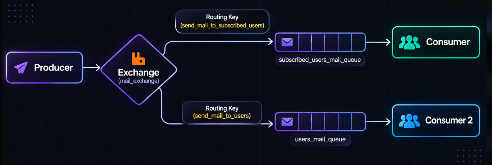
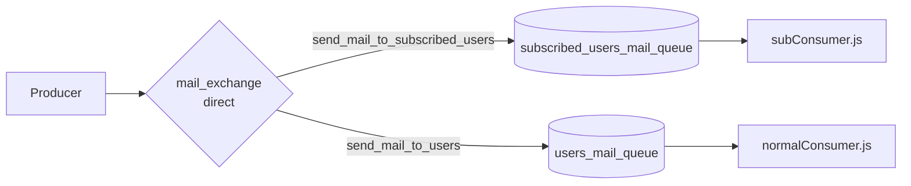

# One Exchange, Multiple Queues

This note explains the routing pattern used in this project.

## Architecture

## Routing table

| Routing key | Bound queue | Consumer |
|---|---|---|
| `send_mail_to_subscribed_users` | `subscribed_users_mail_queue` | `subConsumer.js` |
| `send_mail_to_users` | `users_mail_queue` | `normalConsumer.js` |

## Important distinction

The producer sends two publish operations:

- One message copy with `send_mail_to_subscribed_users`.
- One message copy with `send_mail_to_users`.

The direct exchange routes each copy to the queue bound with the matching key. The queues are independent, so each consumer can process its messages separately.

See [README.md](README.md) for installation, commands, code explanations, reliability notes, and troubleshooting.
