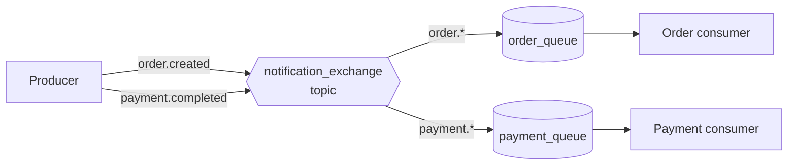

# RQ3: Topic Exchange

A **topic exchange** routes a message by comparing its routing key with the
patterns on queue bindings. It is useful when consumers need flexible,
hierarchical routing without creating a separate exchange for every event.

## How routing works

Routing keys and binding patterns are dot-separated words:

- `*` matches exactly one word.
- `#` matches zero or more words.

For example, `order.*` matches `order.created` and `order.cancelled`, but not
`order.item.added`. `order.#` matches all three.



In this example, a message routed with `order.created` reaches `order_queue`,
and `payment.completed` reaches `payment_queue`. If multiple queues have
matching bindings, each matching queue receives a copy.

## Example in this folder

- [`producer.js`](./producer.js) publishes event messages using routing keys.
- [`orderNotificationService.js`](./orderNotificationService.js) binds
  `order_queue` to `order.*`.
- [`paymentNotificationService.js`](./paymentNotificationService.js) binds
  `payment_queue` to `payment.*`.

The producer publishes events like this:

```js
await publishNotification("order.created", {
  orderId: 123,
  customerId: 45,
});
```

The routing key determines the destination; the JSON body carries the event
data. The example uses persistent messages and durable queues/exchanges so
messages can survive a broker restart, subject to RabbitMQ's persistence and
publisher-confirm guarantees.

## Run it

Start a RabbitMQ broker on `amqp://localhost`, then open separate terminals in
this folder and run:

```sh
node orderNotificationService.js
node paymentNotificationService.js
node producer.js
```

The producer sends one order event and one payment event. Each consumer prints
only the message routed to its queue.

## Why and when to use it

Choose a topic exchange when routing depends on categories or event hierarchies,
and those categories may grow over time. It keeps publishers decoupled from
individual queues: a publisher names an event, while each consumer declares
which event patterns it wants.

## Real-life use case

An online store can publish `order.created`, `order.cancelled`,
`payment.failed`, and `payment.completed`. The fulfillment service can bind to
`order.created`; analytics can bind to `order.#`; and payment handling can bind
to `payment.*`. Adding a new consumer does not require changing the publisher.

## Advantages

- Routes selectively to one or many queues using readable patterns.
- Supports broad subscriptions (`#`) as well as specific event subscriptions.
- Keeps publishers independent of the number and identity of consumers.
- New event categories and consumers can be added through bindings.

## Disadvantages and trade-offs

- Routing-key conventions must be designed and kept consistent.
- Broad patterns such as `#` can deliver more messages than a consumer needs.
- A typo in a routing key or binding can leave a message unrouted. Use the
  `mandatory` publish option and handle returned messages when unrouted
  messages must not be lost.
- Durable queues and persistent messages alone do not prove that a publisher's
  message reached the broker; use publisher confirms for that guarantee.
