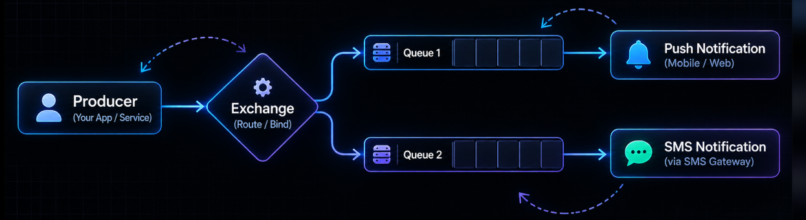
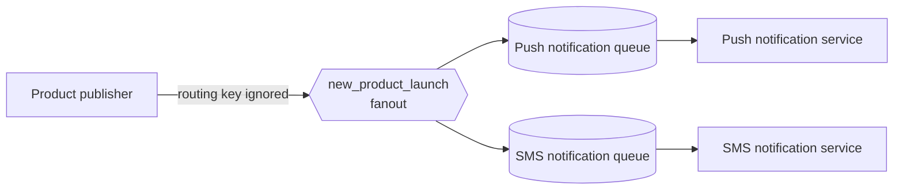

# RQ4: Fanout Exchange

A **fanout exchange** broadcasts every published message to every queue bound
to it. It ignores the routing key, so publishers do not choose a particular
consumer.





RabbitMQ delivers a separate copy to each bound queue. A consumer's
acknowledgement affects only the message in its own queue.

## Example in this folder

- [`producer.js`](./producer.js) publishes a product announcement to
  `new_product_launch`.
- [`pushNotification.js`](./pushNotification.js) binds a queue and simulates a
  push notification.
- [`smsNotification.js`](./smsNotification.js) binds another queue and
  simulates an SMS notification.

Start a RabbitMQ broker on `amqp://localhost`, then run each command in a
separate terminal:

```sh
node pushNotification.js
node smsNotification.js
node producer.js
```

The consumers create exclusive, server-named queues. These queues are
temporary: they are deleted when their consumer connection closes, and they
cannot receive announcements published before they were created. For durable
subscriptions, declare named durable queues and bind them before publishing.

## Why and when to use it

Use fanout when every currently subscribed service should receive the same
event, and the publisher should not know which services are listening. It is
the simplest exchange type for one-to-many notifications.

## Real-life use case

When a product is launched, an application may want to trigger push
notifications, SMS messages, audit logging, and search indexing. Each service
gets its own queue and processes the announcement independently.

## Advantages

- Very simple publish and subscribe behavior.
- Publishers are decoupled from consumer names and routing rules.
- Each consumer queue can process its own copy independently.
- Adding a new bound queue does not require changing the publisher.

## Disadvantages and trade-offs

- Every bound queue receives every message; consumers cannot filter at the
  exchange based on event type.
- A slow consumer accumulates messages in its own queue.
- Temporary exclusive queues do not preserve messages while the consumer is
  offline.
- Persistent delivery options do not make a temporary queue durable.
