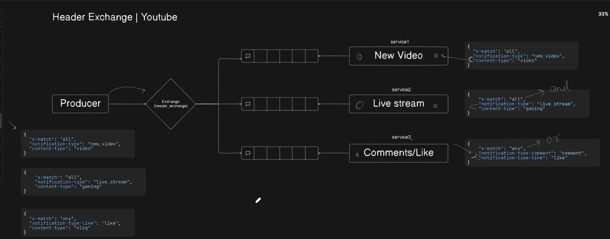
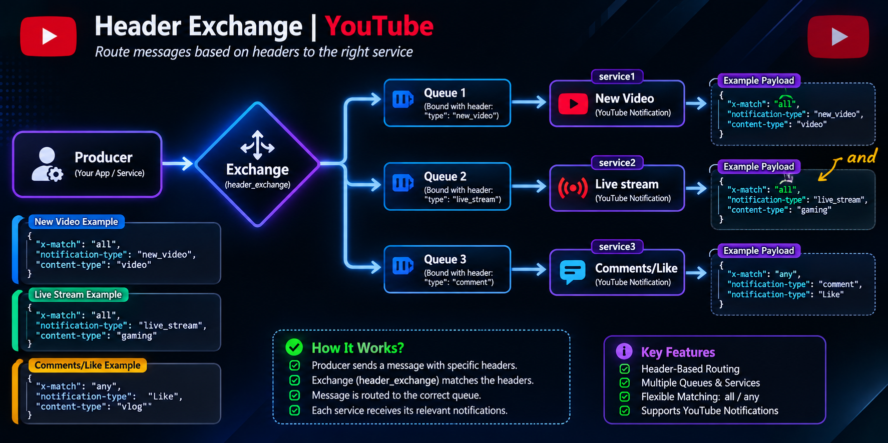
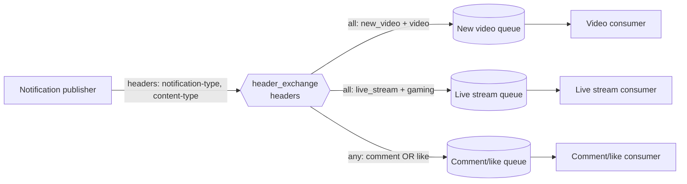

# RQ5: Headers Exchange

A **headers exchange** routes messages by comparing message headers with
arguments supplied by a queue binding. Unlike a topic exchange, it does not
inspect a routing key; publishers generally use an empty routing key.






The special binding argument `x-match` controls how header values are matched:

- `x-match: "all"` requires every listed header to match.
- `x-match: "any"` requires at least one listed header to match.

`x-match` belongs to the **binding arguments**, not the published message
headers. Header names and values must agree between the publisher and binding.

## Example in this folder

- [`producer.js`](./producer.js) publishes four notification variants.
- [`newVideoNotification.js`](./newVideoNotification.js) binds for
  `notification-type: new_video` **and** `content-type: video`.
- [`liveStreamNotifications.js`](./liveStreamNotifications.js) binds for
  `notification-type: live_stream` **and** `content-type: gaming`.
- [`commentLikeNotification.js`](./commentLikeNotification.js) binds with
  `x-match: "any"` for a comment or a like.

Start a RabbitMQ broker on `amqp://localhost`, then run each consumer in a
separate terminal before running the producer:

```sh
node newVideoNotification.js
node liveStreamNotifications.js
node commentLikeNotification.js
node producer.js
```

The example consumers use exclusive, server-named queues. They are intended
for a live demonstration, not durable delivery while a consumer is offline.

## Why and when to use it

Use a headers exchange when routing depends on several message attributes and
those attributes are more natural to express as metadata than as a
dot-separated routing key. `all` is useful for precise classification; `any`
is useful for grouping alternative conditions.

## Real-life use case

A media platform can route video uploads to a video-processing service based
on `content-type: video` and `notification-type: new_video`, gaming broadcasts
to a live-stream service, and either comment or like events to an engagement
service.

## Advantages

- Matches on multiple metadata fields without encoding them into a routing key.
- Can require all binding criteria or accept any one of them.
- Allows publishers and consumers to evolve independently around a shared
  header contract.

## Disadvantages and trade-offs

- Header names and values need a consistent contract; spelling or case
  differences can silently prevent routing.
- Rules can be less visible than routing-key patterns, making them harder to
  inspect at a glance.
- Matching many headers adds configuration complexity and is not a replacement
  for application-level validation.
- As with other exchange types, unrouted messages need explicit handling when
  they must not be lost.
