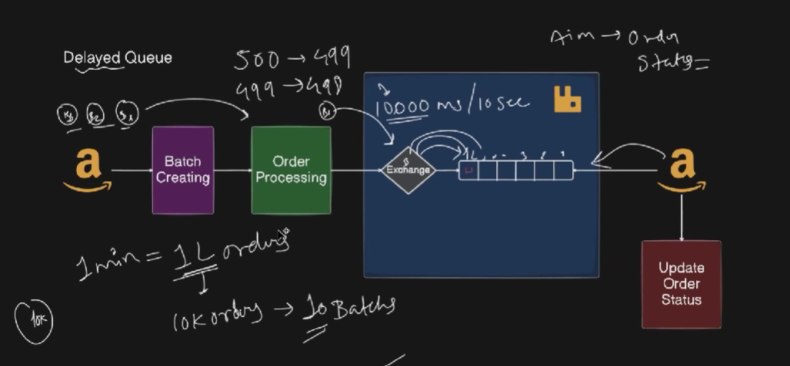
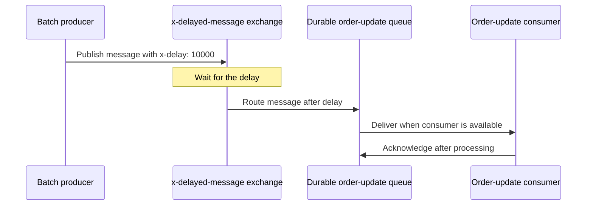

# RQ6: Delayed Messages and Queues

A delayed message is made available for routing only after a specified delay.
The example in this folder uses RabbitMQ's **Delayed Message Exchange** plugin:
the `x-delayed-message` exchange holds the message until its `x-delay`
milliseconds have elapsed, then routes it using the configured exchange type.





The delay controls when the exchange routes the message. It does **not** make
the message disappear if no consumer is running: after the delay, a message
for a durable queue can wait there until a consumer is available.

## Example in this folder

- [`producer.js`](./producer.js) publishes a batch update with an `x-delay`
  header (10 seconds in the sample).
- [`consumer.js`](./consumer.js) consumes from `delayed_order_updates_queue`
  and simulates updating the order statuses.
- [`docker-compose.yml`](./docker-compose.yml) and [`Dockerfile`](./Dockerfile)
  build RabbitMQ with the delayed-message plugin.

The plugin archive included here is version `4.2.0`; the Docker image is pinned
to the matching RabbitMQ 4.2 management image. Start the broker from this
folder:

```sh
docker compose up --build -d
```

Then run the consumer and producer in separate terminals:

```sh
node consumer.js
node producer.js
```

The broker management UI is available at `http://localhost:15672` (default
credentials: `guest` / `guest` for local development). Stop the broker with
`docker compose down`.

## Why and when to use it

Use delayed delivery when work should become eligible at a future time, rather
than immediately. Examples include postponing a reminder, retrying after a
backoff interval, or scheduling a status transition. For large-scale or
long-term scheduling, an external scheduler or a database-backed job system may
be a better fit.

## Real-life use case

After an order is accepted, a service can delay a follow-up status update while
downstream processing runs. Other examples include a “complete your purchase”
reminder sent after a waiting period and retrying a transient operation after
a short delay.

## Advantages

- The broker handles the wait; the producer does not need to sleep or keep a
  timer running.
- Publishers and consumers remain decoupled.
- The delayed exchange can route the message using the selected exchange type
  after the delay.

## Disadvantages and trade-offs

- This feature requires installing and enabling a third-party RabbitMQ plugin;
  it is not a built-in exchange type.
- Plugin and RabbitMQ versions must be compatible on every broker node.
- It is intended for bounded delays, not precise long-term scheduling.
- A delay is not exactly-once processing: consumers should be idempotent and
  should acknowledge only after successful work.
- In the sample, failures while processing are not retried or dead-lettered;
  production systems should define explicit retry and dead-letter policies.
