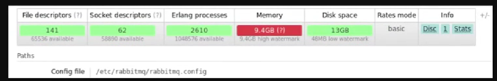
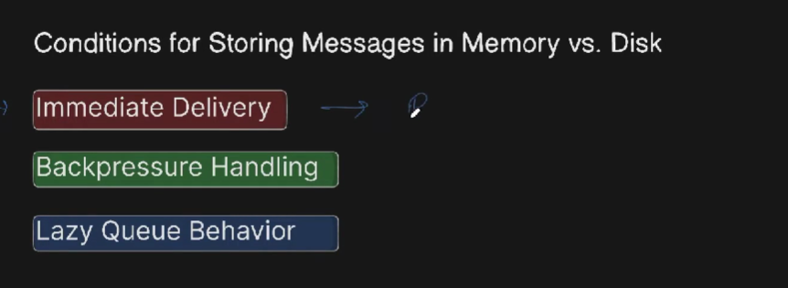
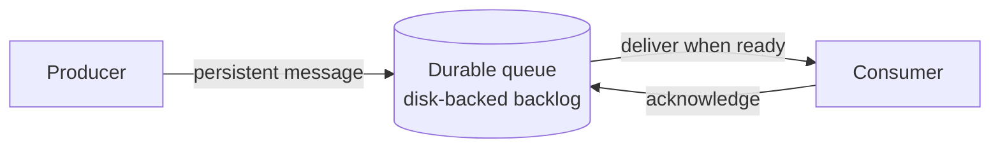

# RQ7: Lazy Queues

A **lazy queue** is a queue configured to keep messages on disk as much as
possible instead of keeping a large backlog in memory. This reduces memory
pressure when messages arrive faster than consumers can process them, at the
cost of disk I/O and potentially higher delivery latency.






## RabbitMQ version note

The explicit `x-queue-mode: lazy` queue argument was used by older RabbitMQ
versions. RabbitMQ 3.12 deprecated lazy queue mode, and RabbitMQ 4.0 removed
it. In RabbitMQ 4.x, classic queues use the newer disk-oriented message
handling by default, so this example declares a durable queue without the
removed argument. Do not add `x-queue-mode: lazy` when using RabbitMQ 4.x.

## Example in this folder

- [`producer.js`](./producer.js) declares a durable direct exchange and queue,
  binds them, and publishes a persistent message.
- [`consumer.js`](./consumer.js) consumes messages and acknowledges successful
  handling.

Start a RabbitMQ broker on `amqp://localhost`, then run:

```sh
node consumer.js
```

In another terminal:

```sh
node producer.js
```

The producer and consumer must use the same queue name. The durable queue
survives broker restarts, while persistent delivery mode asks RabbitMQ to
persist each message. For reliable publishing across connection failures,
production publishers should also use publisher confirms.

## Why and when to use it

Use disk-oriented queue storage when a queue may accumulate a large backlog
and protecting broker memory is more important than minimizing latency. It is
appropriate for workloads where messages can wait longer before processing.

## Real-life use case

A bulk email service may receive a large campaign faster than it can send
messages. A durable, disk-backed queue lets the backlog wait for available
workers without requiring the whole backlog to remain resident in memory.
Other examples include log processing, imports, and deferred background jobs.

## Advantages

- Helps bound memory usage during large backlogs.
- Durable queues and persistent messages can preserve queued work across broker
  restarts.
- Producers can continue enqueueing work while consumers catch up, subject to
  available disk capacity and broker flow control.

## Disadvantages and trade-offs

- Disk I/O can increase latency and reduce throughput compared with a workload
  whose messages are served from memory.
- A disk-backed queue still needs monitoring, sufficient disk capacity, and
  back-pressure handling.
- Queue durability and persistent messages are not a substitute for publisher
  confirms, consumer acknowledgements, idempotency, or appropriate
  replication.
- Modern RabbitMQ versions manage classic-queue storage automatically; the
  older explicit lazy-mode setting is not supported in RabbitMQ 4.x.
