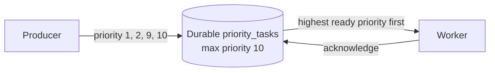

# RQ9: Priority Queues

A **priority queue** lets RabbitMQ prefer higher-priority messages over lower
priority messages that are waiting in the same queue. It is still one queue:
priority changes the order in which ready messages are delivered, not which
consumer receives a message.



The queue must be declared with a maximum priority. This example uses a range
of `0` through `10`; a message with no priority is treated as priority `0`.
The producer and consumer must declare the queue with the same settings.

## Example files

- [`producer.js`](./producer.js) publishes sample jobs with different priority
  values and waits for publisher confirms.
- [`consumer.js`](./consumer.js) fetches one job at a time, processes it, and
  acknowledges it on success.

The producer publishes the ordinary report job at priority `1`, then enqueues
the urgent payment and incident tasks at priorities `9` and `10`. If all jobs
are waiting in the queue, RabbitMQ delivers the highest-priority ready job
first.

## Run it

Start RabbitMQ so that it is reachable at `amqp://localhost`. To observe
reordering, publish the batch **before** starting the consumer:

```sh
node producer.js
node consumer.js
```

The consumer should process the priority `10` and `9` tasks before the lower
priority jobs. If you have already run the example, the durable queue may still
contain messages; let the consumer drain it before repeating the test.

## Important behavior

- Priority only affects messages that are ready and still waiting in the queue.
  It cannot interrupt a message already delivered to a consumer.
- `prefetch(1)` makes the example's ordering easier to see by limiting each
  worker to one unacknowledged message. It does not preempt work already in
  progress.
- A priority queue does not guarantee fairness. Low-priority messages may wait
  a long time if high-priority messages keep arriving.
- Keep the number of priority levels small. Many levels add broker overhead.
- Declare queue priority when creating the queue; RabbitMQ will reject
  incompatible redeclarations of an existing queue.
- The example uses a durable classic queue. Check the current RabbitMQ
  documentation for priority support and constraints before choosing another
  queue type.

## Why and when to use it

Use priorities when certain queued jobs should usually be handled before
others, but all jobs can use the same queue and processing pipeline. Choose a
small, documented priority scale and ensure low-priority work still gets
capacity if the workload requires fairness.

## Real-life use case

A support system can process production outages at priority `10`, account
access issues at `7`, and routine requests at `2`. Workers use the same queue
and job handler, while urgent incidents move ahead of routine work that has
not yet been delivered.

Other examples include time-sensitive payment checks, expedited order
fulfillment, and urgent image or document processing.

## Advantages

- Urgent messages can be processed ahead of lower-priority queued messages.
- Existing queue and worker patterns can be retained.
- Priority is a message property, so the producer can classify each task.

## Disadvantages and trade-offs

- Continuous high-priority traffic can starve lower-priority work.
- More priority levels increase broker resource costs and operational
  complexity.
- Priority does not interrupt work already assigned to a consumer.
- Queue declaration settings must be coordinated between all services.
- Priority ordering should not replace separate queues when workloads need
  different scaling, retention, access control, or failure policies.
